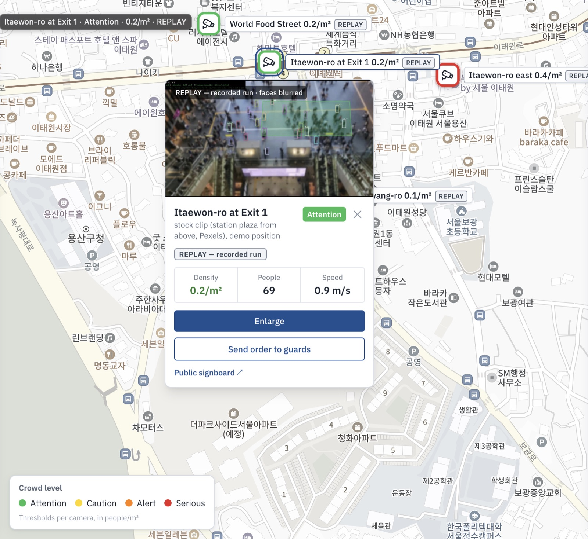
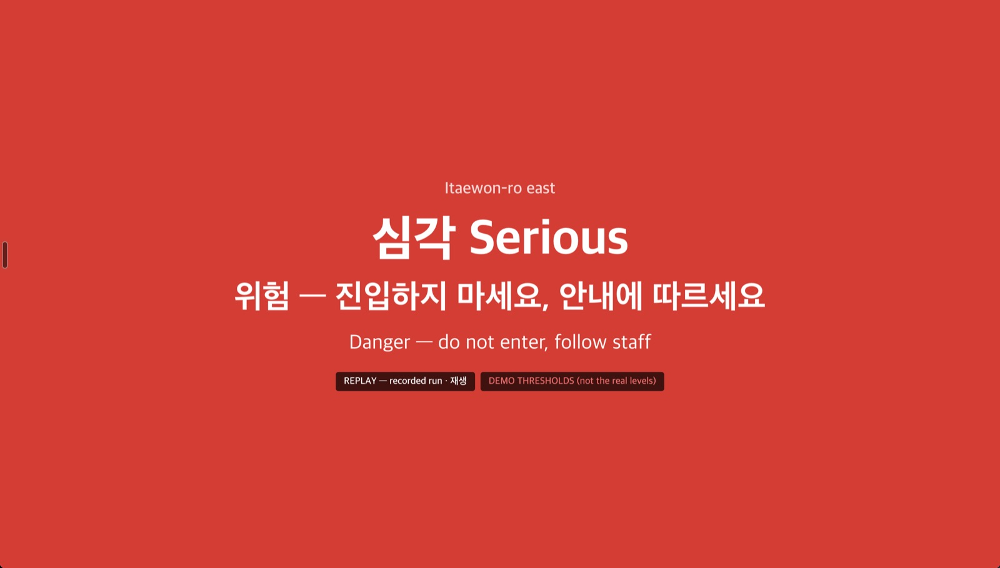
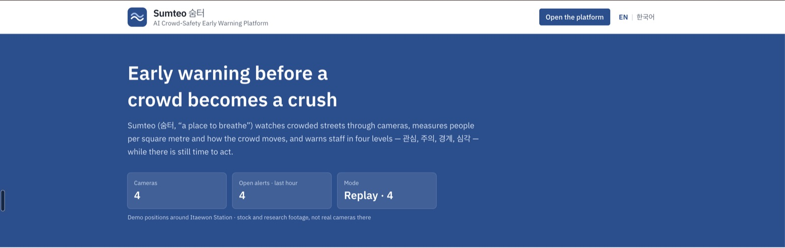
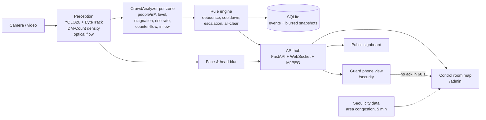

# 숨터 Sumteo — AI Crowd Safety Early Warning System

*숨터 — "a place to breathe". 숨터 — AI 인파 안전 조기경보 시스템.*

Video analytics that warns security staff **before** a crowd crush happens. Per camera zone it measures how many
people stand in each square meter and how the crowd moves — stuck, filling up fast, pushing against itself — and
raises 관심 → 주의 → 경계 → 심각 (GREEN → YELLOW → ORANGE → RED) alerts in time for staff to act: on a phone for guards
on site, and in a map-first control room for the admin.

## The problem

On 29 October 2022, 159 people died in a crowd crush in a narrow alley next to the Hamilton Hotel in Itaewon, Seoul.
The crowd was dense long before the crush: the danger built up over hours and could be seen on camera. Afterwards
Seoul districts installed AI cameras that count people and warn the control room when an area gets too dense.

Sumteo is an open, measurable version of that loop that runs on one laptop: camera → people per m² and crowd flow →
level → alert → a guard acknowledges and goes. It is a study project, **not an official or deployed system**; the cameras
sit at demo positions on the Itaewon map and play stock and research footage. No footage of the 2022 event is used
anywhere.

## Screenshots

| Control room (`/admin`) | Priority pop-up |
|---|---|
|  |  |
| **Camera card** | **Guard phone view (`/security`)** |
|  |  |
| **Public signboard** | **Landing page** |
|  |  |

All views of a replayed camera carry "REPLAY — recorded run"; cameras on demo thresholds carry "DEMO THRESHOLDS".
Faces and heads are blurred in every frame.

## How it works



- **Pixels → meters.** Each camera is calibrated with a homography, so density is people/m² and speed is m/s.
  Thresholds never use pixels.
- **Two ways to count.** Detection (YOLO26 + ByteTrack) for sparse crowds, the DM-Count density map for dense ones; the
  switch point is per camera.
- **Levels are research-based** (Fruin's levels of service): YELLOW 2, ORANGE 4, RED 5 people/m², with hysteresis and
  zone risk factors (slope, narrow, bottleneck). These are not Seoul's official numbers.
- **Rules beyond density:** a stuck crowd (stagnation), density rising fast, counter-flow, more people entering than
  leaving, camera health (lost / frozen / dark). One alert per real change.
- **Routing by severity and role:** guards see alerts with the camera, a snapshot and a mini-map, and answer
  "On my way"; an unanswered CRITICAL goes to the control room as "no response". The control room can send orders
  ("Go to camera", "Stop entry", …) that guards move through "On my way" → "Done".
- **Replay mode:** this laptop can't run four cameras live, so each camera's real pipeline run is recorded once (on the
  laptop or on Google Colab) and the demo plays the recordings — the same frames, levels and alerts, with no models
  loaded. Every replayed view is tagged "REPLAY — recorded run".

Full design: [docs/ARCHITECTURE.md](docs/ARCHITECTURE.md). Data and calibration: [docs/DATA.md](docs/DATA.md).

## Results

Everything below was measured; details and limits in [docs/results.md](docs/results.md).

| What | Result |
|---|---|
| Crowd counting, ShanghaiTech B test (316 images) | DM-Count MAE **7.34**, RMSE 11.82 (paper: 7.4 / 11.8) |
| Held-out stock clips, plaza from above (real thresholds, no camera setup) | count MAE 51.0 (**about −80%**) — high, wide views need the density model |
| Held-out real CCTV, CroHD HT21-03 crossing (40 s, run once) | count MAE 76.2 (**about −49%**); follows the build-up and clearing, but counts about half the people |
| Level change → alert (demo thresholds, 3 labeled changes) | 1.00 alerts per change, **+2.7 s** after the change |
| False alarms (ORANGE / RED on calm footage) | 0 in 67 s of distinct footage (too short for a per-hour rate) |
| Rule fires → both dashboards | **0.08–1.5 s** |
| Unanswered CRITICAL → control room | re-sent at exactly 60 s |

Level accuracy on stock footage is 100% but **trivial**: real stock crowds stay GREEN. The rules are proven mostly on
fake metric sequences in the unit tests; danger levels are shown on the demo cameras with demo thresholds, marked
"DEMO" on screen.

## Run it

Both options need two things first:

1. **Recordings** in `data/recordings/` — see [Recordings](#recordings-and-live-cameras).
2. **Your own Kakao Maps key** in `dashboard/.env.local`, with `http://localhost:3000` added as a site domain — see
   [Map key](#map-key). Without it everything works except the map, which shows "Map unavailable".

### Option A — Docker (replay demo, no models)

```bash
docker compose up --build
```

Then open http://localhost:3000. Build the images locally only: the dashboard image contains your Kakao key, so never
push it to a public registry.

### Option B — on your machine

Requirements: Python 3.12 with [uv](https://docs.astral.sh/uv/), Node 20+.

```bash
uv venv --python 3.12 && source .venv/bin/activate
uv pip install -e ".[dev]"
pytest                                             # 105 tests, no video needed (2 skip without the YuNet face model)
```

Replay demo (four recorded cameras):

```bash
python scripts/serve.py --replay data/recordings/crowd-demo-1 data/recordings/crossing-demo-1 data/recordings/test-crowd-03 data/recordings/test-crowd-04
```

Dashboard, in a second terminal:

```bash
cd dashboard && cp .env.example .env.local        # fill in NEXT_PUBLIC_KAKAO_MAP_KEY
npm install && npm run build && npm start
```

Open http://localhost:3000 and pick **Control room** or **Security (guard)**.

### Recordings and live cameras

The demo plays recordings from `data/recordings/<camera_id>/` (video, timeline, blurred snapshots, manifest).

Recordings are not published (the clips carry their own licences), so record them yourself with the real pipeline,
one camera at a time — on Google Colab with
[`notebooks/record_colab.ipynb`](notebooks/record_colab.ipynb), or locally:

```bash
python scripts/record_camera.py --camera configs/cameras/crowd_demo.yaml --out data/recordings/crowd-demo-1
```

This needs the clips in `data/raw/` and the weights in `models/` (see [docs/DATA.md](docs/DATA.md)). A replay refuses to
start when the config or an input file changed since recording ("recording is stale, re-record").

One camera can also run live next to the replays (Apple MPS or CUDA recommended):

```bash
python scripts/serve.py --cameras configs/cameras/crowd_demo.yaml
python scripts/run_camera.py --camera configs/cameras/crowd_demo.yaml    # one camera in a local window, no API
```

### Public signboard and city data

- **Signboard:** http://localhost:3000/signboard/<zone> (e.g. `/signboard/crossing`) — a full-screen board in Korean
  and English for a screen on the street; each camera card in the control room links to its zones' boards.
- **Seoul city data** (optional): get a free key at [data.seoul.go.kr](https://data.seoul.go.kr) and put
  `SEOUL_API_KEY=…` in `.env` (copy `.env.example`). The control room then shows Seoul's own congestion label for
  이태원 관광특구 next to the cameras: a mobile-signal estimate for the whole area, every 5 min with ~15 min delay. It
  never changes a camera's level or raises an alert.

### Map key

The map uses the Kakao Maps JavaScript SDK. Create an app at [developers.kakao.com](https://developers.kakao.com),
copy its JavaScript key into `dashboard/.env.local` as `NEXT_PUBLIC_KAKAO_MAP_KEY`, and add your site domain
(e.g. `http://localhost:3000`) under the app's Web platform. Without a key the dashboards work, but the map stays empty.

## Privacy and ethics

- **Faces are detected only to be blurred** (YuNet, plus the top of every person box for faces too small to detect).
  No face recognition, no identities, no tracking across cameras.
- Frames are blurred **before** they are streamed, recorded or saved as a snapshot. Raw video is not stored.
- No footage of the 2022 Itaewon crowd crush is used, and the event is not re-enacted. The landing page's density
  illustration is a generic 10 × 4 m zone.
- Thresholds come from research (Fruin), not from Seoul's official numbers.
- A human always sees a CRITICAL alert; nothing in the system downgrades or hides one.

## Limitations

- **Stock and research footage only.** No clip shows real crush-level density, so danger levels are demonstrated on
  demo thresholds (marked "DEMO"), and the rules are proven mostly on fake metric sequences.
- **Counts read low on dense real CCTV** (about half on CroHD HT21-03, worse as the crowd grows): every people/m²
  reading is then low too, the unsafe direction. Not corrected — a fix needs new footage, not the held-out clip.
- **Fixed cameras, daytime only.** Night, rain and moving cameras are untested; calibration is estimated per clip
  (±10–30% area).
- Turbulence is tuned only on calm footage; outflow counts run high on one clip.
- One laptop can't run four cameras live (hence replay mode); real sites need a GPU server per few cameras.
- Needs validation at a real site, with real ground truth, before anyone relies on it.

## What a real deployment would add

Telecom base-station population data, transit-card and station-exit counts, drones over alleys, location-targeted
disaster text messages, a KakaoTalk business channel, subway "skip station" control and police / fire dispatch — all
need government access, so they are listed as integration points ([ARCHITECTURE §6](docs/ARCHITECTURE.md)). Also: proper
user accounts instead of demo roles, and a measured false-alarm rate over hours of real footage.

## Project layout

```
configs/            default.yaml (real thresholds) + cameras/*.yaml (source, location, zones, calibration, overrides)
src/sumteo/
  video/            VideoSource → Frame
  perception/       detector (YOLO26 + ByteTrack, behind PersonTracker), density (DM-Count), optical flow
  geometry/         zones, homography (pixels ↔ meters)
  analytics/        track state, CrowdAnalyzer
  events/           Event model, RuleEngine (debounce / cooldown / escalation), orders, notifiers
  privacy/          face and head blur
  storage/          SQLite
  api/              FastAPI + WebSocket + MJPEG, camera and replay workers
  pipeline.py       per-camera loop
scripts/            serve, run_camera, record_camera, calibrate, eval_crowd, stabilize_video
notebooks/          record_colab.ipynb (record on Colab's GPU)
dashboard/          Next.js: landing page, /admin control room, /security guard view
data/  models/      git-ignored
```

## Credits

- Crowd crossing footage: **CroHD** HT21-03 (Sundararaman et al., *Tracking Pedestrian Heads in Dense Crowd*, CVPR 2021),
  CC BY-NC-SA 3.0 — recordings made from it carry the same licence.
- Other demo clips: [Pexels](https://www.pexels.com) (Pexels licence); sources per camera in [docs/DATA.md](docs/DATA.md).
- Models: [Ultralytics YOLO26](https://github.com/ultralytics/ultralytics) (AGPL-3.0),
  [DM-Count](https://github.com/cvlab-stonybrook/DM-Count), YuNet face detector (OpenCV Zoo).
- Map: Kakao Maps. Landing-page photos and their licences: [dashboard/public/landing/CREDITS.md](dashboard/public/landing/CREDITS.md).
- Screenshots in `docs/screenshots/` contain blurred CroHD frames, so they are CC BY-NC-SA 3.0 like the recordings,
  and Kakao Maps tiles (© Kakao).

## Status

Day 1 done: people tracking with stable IDs, calibrated zones and counting lines, walking speed (m/s), standing time
and line crossings. Measured: 26.5 FPS, walkers ~1.0 m/s, standing people ~0.1 m/s.

Day 2 done: people/m² per zone from detection or the density map, 관심 → 심각 levels with hysteresis and risk factors,
and a rule engine that sends one alert per real change. Measured: DM-Count MAE 7.34 on ShanghaiTech B.

Day 3 done: optical-flow speed, turbulence and counter-flow, the rules for a stuck crowd, fast rise, counter-flow and
inflow, plus camera health. Measured: calm footage fires nothing; a covered lens raises one camera alert.

Day 4 done: faces and heads blurred before anything is shown or saved, alerts stored with blurred snapshots, and
measured on hand-counted clips. The held-out clips showed that high, top-down cameras under-count unless set up to use
the density model.

Day 5 done: alerts reach the people on duty in the platform — a control room and a phone view for guards, with sound,
notifications, acknowledgement and escalation. Measured: a rule firing reaches both roles in under 1.5 s.

Day 6 done: replay mode with recording on Colab, a map-first control room on the Itaewon map, orders to guards,
the landing page, "Acknowledge all", a held-out check on real CCTV (CroHD HT21-03, count −49%), the plaza cameras
set up with the density model for their demo recordings (Day 4's held-out numbers stand as measured), a replay-only Docker demo, the
public signboard and Seoul city data. Checked: `docker compose up` plays all four cameras; a clean copy runs from this
README.

Bridge mode (railing / climbing detection) was split out and is kept in `../bridge-safety-ai/`.
