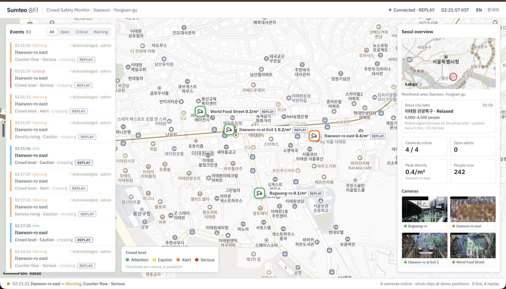
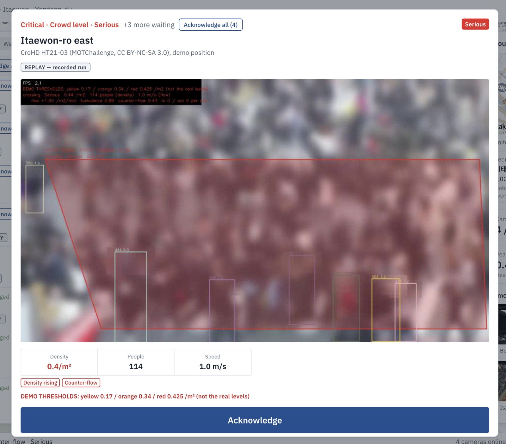
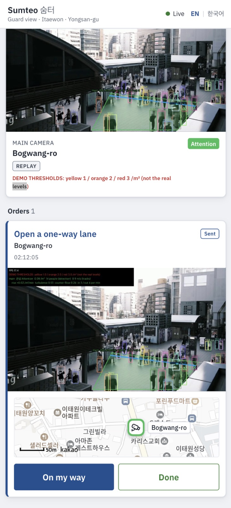
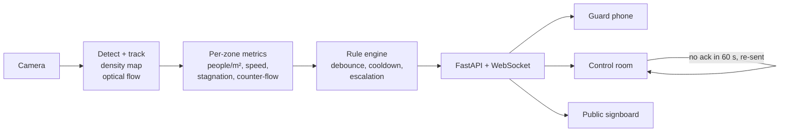

# 숨터 Sumteo — AI crowd-safety early warning

Built to warn security staff **before** a crowd becomes a crush. From CCTV it measures people per m² and how the
crowd moves, and raises 관심 → 주의 → 경계 → 심각 (Attention → Caution → Alert → Serious) alerts to guards' phones
and a map-based control room.

**Why:** in the 2022 Itaewon crowd crush, 159 people died in a narrow alley; investigators called it a man-made
disaster of failed prevention and response. Sumteo is modelled on the AI crowd monitoring Seoul installed afterwards.

> Study project, not a deployed system. Cameras sit at demo positions on the Itaewon map and play stock and research
> footage. No footage of the 2022 event is used.

| Control room | Alert pop-up | Guard phone view |
|---|---|---|
|  |  |  |

More: [camera card](docs/screenshots/camera-card-exit1.jpg) · [public signboard](docs/screenshots/signboard-red.jpg) ·
[landing page](docs/screenshots/landing.jpg)

## How it works



- **Metric, not pixels:** each camera is calibrated (homography), so thresholds are in people/m² and m/s.
- **Two counters:** YOLO26 + ByteTrack for sparse crowds, DM-Count density maps for dense ones.
- **Research-based levels** (Fruin): 2 / 4 / 5 people/m², plus rules for a stuck crowd, fast-rising density,
  counter-flow, inflow > outflow and camera faults. These are not Seoul's official numbers.
- **One alert per real change,** routed by severity: critical alerts go to guards and the control room at once; if
  nobody acknowledges within 60 s, the control room gets it again as "no response". The control room can send orders
  to guards, who answer "On my way" → "Done".
- **Privacy:** faces and heads are blurred before any frame is streamed, recorded or saved. No face recognition, no
  identities.
- **Replay mode:** one laptop can't run four cameras live, so each camera's real pipeline run is recorded once and the
  demo replays it without models. Replayed views are always labelled "REPLAY".

Stack: Python 3.12, PyTorch, OpenCV, FastAPI, SQLite · Next.js 16, React 19, Tailwind, Kakao Maps · Docker.
Design details: [ARCHITECTURE](docs/ARCHITECTURE.md) · data and calibration: [DATA](docs/DATA.md).

## Results

All measured; method and caveats in [docs/results.md](docs/results.md).

| Check | Result |
|---|---|
| Counting, ShanghaiTech B (316 images) | MAE **7.34** (paper: 7.4) |
| Held-out stock clips, plaza from above (run once) | counts **~80% low**: detection on a high view; fixed by setting the camera up for density |
| Held-out real CCTV, CroHD crossing (run once) | follows the build-up, but counts **~49% low** |
| Level change → alert (demo thresholds) | **+2.7 s**, one alert per change |
| Rule fires → both dashboards | **0.08–1.5 s** |
| False alarms on calm footage | 0 in 67 s (too short to give a rate) |

**Limits:** no stock clip reaches crush density, so danger is shown on demo thresholds (marked "DEMO"), and the rules
are proven mostly in unit tests. Counts read low on dense real CCTV, which is the unsafe direction. Fixed daytime
cameras only. A real site needs its own validation first.

## Run it

You need **recordings** in `data/recordings/` (not published; record them on Colab with
[`notebooks/record_colab.ipynb`](notebooks/record_colab.ipynb) or with `scripts/record_camera.py`). For the map you
also need a **Kakao Maps JavaScript key** in `dashboard/.env.local` with `http://localhost:3000` allowed; without it
the map shows "Map unavailable".

```bash
docker compose up --build        # replay demo → http://localhost:3000
```

Or without Docker (Python 3.12 + [uv](https://docs.astral.sh/uv/), Node 20+):

```bash
uv venv --python 3.12 && source .venv/bin/activate && uv pip install -e ".[dev]"
pytest                           # 105 tests, no video needed
python scripts/serve.py --replay data/recordings/*
cd dashboard && cp .env.example .env.local && npm install && npm run build && npm start
```

Optional: put `SEOUL_API_KEY=…` (free, [data.seoul.go.kr](https://data.seoul.go.kr)) in `.env` to show Seoul's
live congestion for Itaewon next to the cameras. Build images locally only, because the dashboard image contains
your Kakao key.

## Credits

- Footage: **CroHD** HT21-03 (Sundararaman et al., CVPR 2021, CC BY-NC-SA 3.0; the recordings and screenshots made
  from it keep that licence) and [Pexels](https://www.pexels.com) clips. Sources are listed in [DATA](docs/DATA.md).
- Models: [Ultralytics YOLO26](https://github.com/ultralytics/ultralytics) (AGPL-3.0),
  [DM-Count](https://github.com/cvlab-stonybrook/DM-Count), YuNet (OpenCV Zoo).
- Map tiles © Kakao. Landing-page photo credits: [CREDITS](dashboard/public/landing/CREDITS.md).

## Status

All six plan days are done: tracking, density and levels, flow rules, privacy and evaluation, live alerts and
dashboards, then replay mode, Docker, the signboard and city data.
