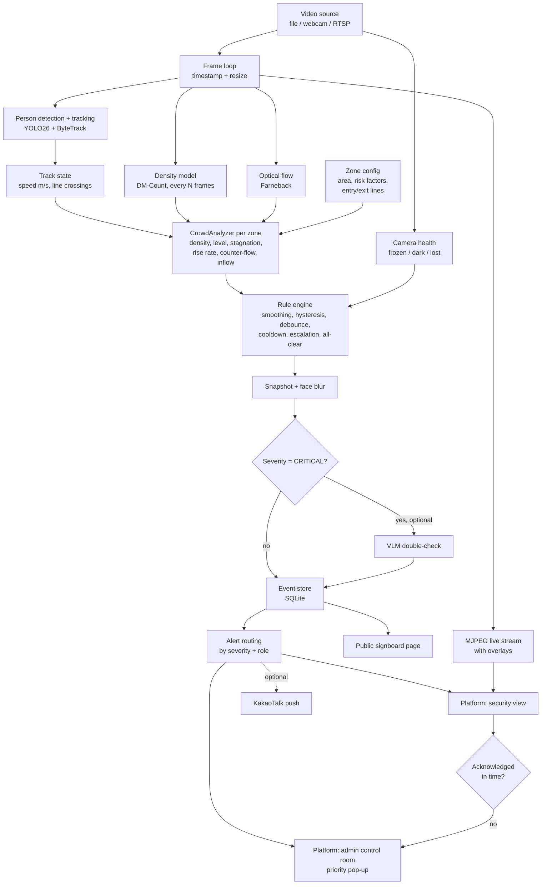

# Architecture — 숨터 Sumteo

One video-analytics engine with one goal: **prevent crowd crush (Itaewon-type disasters)**.
It watches not only *how many* people are in a zone, but *how the crowd behaves*: stuck, filling up fast,
pushing against itself. Those are the signals that turn a crowded street into a deadly one.

> Scope: crowd only. Bridge mode was split out (kept in `../bridge-safety-ai/`).
>
> Model: the district systems Seoul built after Itaewon (AI CCTV counting people per m², 4-tier levels,
> alerts mirrored to district / city / police / fire, priority camera pop-up, public signboards, slope and
> inflow data in the risk index). This project is an open, measurable version of that loop that runs on one laptop.

---

## 1. High-level flow



---

## 2. Layers

### 2.1 Video (`src/sumteo/video/`)
- `VideoSource` wraps OpenCV `VideoCapture` for file, webcam index or RTSP URL.
- Yields `Frame(image, ts, index)`. For files, `ts` comes from the frame index / FPS so results are reproducible.
- Optional `target_fps` frame skipping keeps processing real-time on a laptop.
- **Camera health:** the source reports when the feed is lost (read fails / reconnect fails), frozen (no pixel
  change for `frozen_seconds`) or dark (mean brightness below `dark_mean_below`). A dead camera at a hotspot is a
  silent failure, so it raises `CAMERA_HEALTH`.
- `overlay.py` — draws boxes, IDs, zones, lines, level colors and labels. Korean labels go through Pillow with the
  macOS AppleSDGothicNeo font (OpenCV can't draw Hangul); if the font is missing, labels fall back to English.
- **Demo tag:** when a camera overrides `crowd.levels_ppm2`, the metrics panel shows a red line
  "DEMO THRESHOLDS: yellow … / orange … / red … /m² (not the real levels)" with the values in use, so a demo can't be
  mistaken for real danger. `CameraConfig` keeps its `overrides` dict after merging so this can be detected.

### 2.2 Perception (`src/sumteo/perception/`)
| Module | Model | Output | Frequency |
|---|---|---|---|
| `detector.py` | YOLO26n/s (person class only) + ByteTrack | `list[Detection(track_id, bbox, conf)]` | every frame |
| `density.py` | DM-Count (authors' weights: SH-B default; SH-A / NWPU per camera) | density map + count | every N frames (≈1 fps) |
| `flow.py` | OpenCV Farneback optical flow | mean speed, direction histogram, turbulence | every 2–3 frames |

Detector settings live in config `models:` (`detector`, `detector_imgsz` 1280, `detector_conf` 0.1, `tracker`); tracker
thresholds live in `configs/bytetrack.yaml` (high 0.2, low 0.05, new track 0.3, buffer 30 frames = `tracking.lost_after_s`
at 15 fps, match 0.95). Why: in high, wide-angle shots people are small, so imgsz 640 finds almost nobody and stock
ByteTrack churns IDs. The low `detector_conf` only feeds ByteTrack's second-stage matching; a new track still needs ≥ 0.3,
so weak false boxes don't become tracks.

**Why two counting methods?** Detection works well up to ~2–3 people/m². In dense crowds people
are occluded and detection under-counts badly, so the density model takes over.

**Switch rule** (per zone): the density model's own people/m² decides. Below `crowd.switch_density_ppm2` (2.5) the
zone uses the detection count; from 2.5 up it uses the density count. Detection saturates in crowds, so it can't be
the one that triggers the switch. Before the first density run, detection is used. At low density detection is the
better count (crowd_02 zone `main`, 148 m²: detection 13.4 people on average, DM-Count SH-B 11.4, SH-A 10.5).

**Density weights per camera:** the default `models.density` is `models/dmcount_shb.pth` (street scenes). Dense
cameras set `models.density: models/dmcount_sha.pth` in their camera YAML `overrides:` — on the dense Shibuya clip
(crowd_05) SH-B counts 44 and SH-A 322. Very high, top-down views with tiny people use `models/dmcount_nwpu.pth`
(`crossing_demo`: NWPU 154 vs ~150 by eye; SH-A 84–140, scale-sensitive). The pipeline sums the density map inside each zone mask.
DM-Count is MIT-licensed; its model is re-declared in `perception/density.py` and loads the authors' weights.

### 2.3 Geometry (`src/sumteo/geometry/`)
- `zones.py`
  - `Polygon` — crowd area, point-in-polygon. A camera can have **several zones**; each gets its own level.
  - `Line` — entry / exit counting lines (a segment); `side(pt)` tells which side a foot point is on. What counts as a
    crossing is in §2.5.
- `calibration.py` — homography from 4 clicked image points ↔ 4 real-world points (meters).
  Converts pixel positions to meters → speeds in m/s and zone areas in m².
  Without calibration, nothing in m² or m/s is meaningful, so every camera config has one.

### 2.4 Zone config (`configs/cameras/*.yaml`)
```yaml
zones:
  - id: alley
    polygon: [[x, y], ...]          # pixels
    risk: {slope: true, narrow: true, bottleneck: false}
    entry_line: [[x1, y1], [x2, y2]] # optional, for inflow counting
    exit_line:  [[x1, y1], [x2, y2]]
```
**Risk factors** (Seoul's risk index uses slope data for the same reason — the Itaewon alley was steep and narrow):
each flag multiplies the zone's level thresholds by a factor from `crowd.risk_factors`, never below
`crowd.risk_factor_floor`. Example: slope (0.85) × narrow (0.9) → a steep alley turns RED at ~3.8 instead of 5 people/m².

### 2.5 Analytics (`src/sumteo/analytics/`)

**`state.py` — TrackState** (per track ID)
- ring buffer of `(ts, foot_point_px, foot_point_m)`
- `speed_mps` (smoothed over last ~1 s), `still_seconds`
- `seconds_in_zone: dict[zone_id, seconds]` — a camera has several zones, so time is kept per zone
- line crossings for inflow counting: `last_side` keyed by line id `"<zone>:entry"` / `"<zone>:exit"` (+1 / -1)
- `TrackStore.update(ts, detections, homography, zones)` takes all of the camera's zones and returns this frame's new
  `Crossing(ts, line_id, track_id, direction)` list; running totals in `TrackStore.crossing_counts[line_id][direction]`

**Crossing rule** — a raw side change between frames miscounts: a foot standing on the line jitters across it, and
someone walking past a line's end crosses its infinite extension. So:
- the side is judged on the track's **median foot position** (median x and y in metres) over the last
  `tracking.speed_window_s`, and only once the track has at least half a window of history (the same rule as speed).
  Why: a half-hidden person's box shrinks and the foot point jumps 0.5–1.5 m for one frame; near the far line
  1 px ≈ 10 cm, so the band alone doesn't absorb it (crowd_02: 36 → 14 crossings)
- a side is only registered once that median foot point is ≥ `tracking.line_band_m` (0.3 m, world metres) from the line;
  inside the band the last registered side is kept, so standing on the line never counts
- a crossing = the registered side flips **and** the median foot projects onto the segment between its two endpoints
- `direction` = the new side (+1 / -1), so inflow / outflow can use direction instead of assuming every entry-line
  crossing is someone coming in
- no calibration (homography `None`) → line counting is skipped, because the band is in metres; zone timers still work
- known limitation: ByteTrack ID switches inside a tight standing group on the line, and lost IDs re-matched to a
  different person after a gap, still double-count. A fix (e.g. a "teleport guard") is an open Day 3 decision

**`crowd.py` — CrowdAnalyzer → `CrowdMetrics`** (one analyzer per zone, per second)
- `CrowdAnalyzer(cfg, zone_id, zone_area_m2, risk_factor)`;
  `update(ts, detection_count, density_count, median_speed_mps) → CrowdMetrics`; `conditions(metrics) → list[Condition]`
- `risk_factor(cfg, zone.risk)` = product of the flagged factors, floored at `risk_factor_floor`
- Day 3 fields (flow, turbulence, counter-flow, rise, inflow / outflow) stay 0.0 until Day 3

| Metric | How |
|---|---|
| `count` | hybrid detection / density |
| `density_ppm2` | count ÷ zone area (m²), **median over the last `smoothing_s`** |
| `flow_speed` | mean optical-flow magnitude inside zone |
| `median_speed_mps` | median walking speed of tracks in the zone |
| `turbulence` | variance of flow directions (people pushing in different directions = danger) |
| `counter_flow` | share of flow vectors opposite to the main direction |
| `rise_ppm2_per_min` | slope of density over the last `rise_window_s` |
| `inflow_per_min` / `outflow_per_min` | entry / exit line `Crossing`s (with direction, §2.5 crossing rule) |
| `level` | from thresholds below, with risk factors and hysteresis |

**Levels** — thresholds from crowd-safety literature (Fruin levels of service), labeled with the Korean national
crisis-level names so operators read them the way they already do:

| Level | Label | people/m² (default) | Meaning |
|---|---|---|---|
| GREEN | 관심 Attention | < 2 | free movement |
| YELLOW | 주의 Caution | 2 – 4 | dense, restricted movement |
| ORANGE | 경계 Alert | 4 – 5 | critical, bodies touching |
| RED | 심각 Serious | ≥ 5, or ORANGE with high turbulence | crush risk — act now |

> These numbers are *not* Seoul's official thresholds (those aren't published). They warn a little earlier than
> commonly quoted crush figures (5–6+), on purpose: the system exists to buy time.

**Hysteresis:** a level goes **up** at its threshold but only comes **down** when density falls `hysteresis_ppm2`
below it (e.g. ORANGE at 4.0, back to YELLOW under 3.6). This stops a crowd sitting at 3.95–4.05 from flipping every second.
A RED reached through turbulence doesn't change the stored base level that hysteresis works from.

### 2.6 Rules → conditions

The analyzer emits `Condition`s; the rule engine decides which become events.

| Event | Condition (all thresholds in config `crowd:`) | Severity |
|---|---|---|
| `CROWD_LEVEL` | emitted every update while level ≥ YELLOW (`details.level`); the engine turns it into one event per activation / severity change | YELLOW → INFO, ORANGE → WARNING, RED → CRITICAL |
| `STAGNATION` | level ≥ `stagnation_min_level` **and** `median_speed_mps` < `stagnation_speed_mps` for ≥ `stagnation_seconds` — the crowd is stuck (the Itaewon pattern) | WARNING; CRITICAL if level ≥ ORANGE |
| `DENSITY_RISING` | `rise_ppm2_per_min` > `rise_ppm2_per_min` threshold while density ≥ `rise_min_density` — **early warning** before ORANGE | WARNING |
| `COUNTER_FLOW` | `counter_flow` > `counter_flow_warn` while level ≥ YELLOW — two streams colliding | WARNING |
| `INFLOW_IMBALANCE` | `inflow_per_min` ≥ `inflow_min_per_min` and inflow ÷ outflow > `inflow_ratio` over `inflow_window_s` — the zone is filling | WARNING |
| `CAMERA_HEALTH` | feed lost / frozen / dark (see 2.1) | WARNING |
| `ALL_CLEAR` | emitted while GREEN; the engine fires it only if that zone fired WARNING/CRITICAL since its last all-clear | INFO |

Conditions are emitted **continuously** while true; deciding what
becomes an event is the engine's job. Rules not listed with a severity mapping use `DEFAULT_SEVERITY`.

Turbulence is used only inside the RED escalation for now (hard to tune as its own rule on stock video).

### 2.7 Events (`src/sumteo/events/`)
- `models.py` — `Condition(type, zone_id, track_id, details)`, `Event(id, camera_id, type, severity, ts, zone_id, details, snapshot_path, verified, acknowledged)`
- `engine.py` — `RuleEngine`
  - **key**: `(zone or track, type)`, one engine per camera; a key fires **once per activation**
  - **debounce**: per severity — a condition (or a new severity of it) must hold `debounce_s` before it fires (kills flicker)
  - **escalation**: a higher severity fires immediately, even inside a cooldown
  - **de-escalation**: a drop in severity is silent but re-arms the key, so a later rise alerts again
  - **cooldown**: a key that stops and comes back within `cooldown_s` at the same or lower severity is blocked
  - **combine**: conditions firing for the same zone in the same `update` call go out as **one** event with the highest
    severity and `details.reasons` listing all types (e.g. CROWD_LEVEL RED + STAGNATION), not as separate alerts
  - **all-clear**: one `ALL_CLEAR` when the zone returns to GREEN, only if it fired WARNING/CRITICAL since the last one
    - no cooldown on `ALL_CLEAR` — the WARNING/CRITICAL gate is enough; with a cooldown, ORANGE → GREEN → ORANGE → GREEN
      inside `cooldown_s` swallowed the second all-clear and operators were never told the zone was calm
    - firing an `ALL_CLEAR` clears that zone's cooldowns: once declared calm, a new rise is a new situation and alerts,
      even within `cooldown_s` of the previous alert

### 2.8 Alert routing (`src/sumteo/events/notifiers/`)
Alerts live **in the platform**: the people on duty watch the dashboard, so that is where alerts appear first.
Like Seoul's system, which mirrors one alert to district, city, police and fire at once — but routed by severity
and role so each group only gets what it must act on. Routes live in config `notifiers.routes`:

| Severity | Goes to | Meaning |
|---|---|---|
| INFO | admin feed | log it |
| WARNING | + **security** view | on-site guards: check the zone, get ready |
| CRITICAL | + **admin** pop-up + optional KakaoTalk | control room: act now |

- **Roles:** `security` (on-site guards, phone or tablet) and `admin` (control room). The demo picks the role on a
  simple login screen; a real deployment needs proper accounts.
- **Getting noticed:** sound + browser notification (works when the tab is in the background) + priority pop-up.
- **Acknowledge:** an alert stays highlighted until someone acknowledges it; who and when is stored.
- **Escalation:** a CRITICAL not acknowledged within `ack_timeout_s` is re-sent to admin, marked "no response".
- **KakaoTalk (optional):** the messenger Koreans actually use. Demo: Kakao Developers "send to me" API with the
  operator's own token. Production: business channel + AlimTalk (알림톡). Sends text + a link to the event,
  not the photo, so snapshots stay on the platform.

Notifiers: `console`, `platform` (WebSocket push per role), `kakao`.

### 2.9 Verification (`src/sumteo/verify/vlm.py`) — optional
For CRITICAL events only, send the **face-blurred** snapshot to a vision LLM:
"Is this crowd dangerously dense or pushing? Answer yes/no + reason."
Used to *annotate* the alert (never to suppress a CRITICAL alert silently — a human always sees it).

### 2.10 Privacy (`src/sumteo/privacy/blur.py`)
- Face **detection** only (to blur), never face **recognition**. No identities are stored.
- Snapshots are blurred before they are saved, shown on the platform or sent to a VLM. KakaoTalk gets a link, not the photo.
- Raw video is not stored by default — only event snapshots.

### 2.11 Storage and API
- `storage/db.py` — SQLite tables: `events`, `crowd_metrics` (1 row per zone per second).
- `api/server.py` — FastAPI
  | Endpoint | Purpose |
  |---|---|
  | `GET /cameras` | camera list + current level per zone + camera health |
  | `GET /cameras/{id}/stream` | MJPEG stream with overlays |
  | `GET /events?camera=&severity=` | event history |
  | `POST /events/{id}/ack` | security / admin acknowledges an alert (role + time stored) |
  | `GET /metrics/{camera}?since=` | crowd density time series |
  | `GET /signboard/{zone}` | data for the public signboard page |
  | `WS /ws?role=security\|admin` | live push of events (filtered by role) + metrics |

### 2.12 Dashboard (`dashboard/`, Next.js)
- Camera grid with live MJPEG, zone overlays and level labels (color + 관심/주의/경계/심각)
- **Priority pop-up:** when a camera hits ORANGE/RED its feed jumps to a large view at the top with a sound,
  until acknowledged (Seoul control rooms do the same)
- Two views: **security** (my zones, big alert cards, Acknowledge — works on a phone) and **admin** (all cameras, pop-ups, history)
- Alert feed (color by severity, "Acknowledge" button, escalation mark), camera-health badges, sound + browser notification
- Crowd density chart per zone with level bands
- Event detail: blurred snapshot, rules that fired, VLM note
- **Demo tag:** every view that shows a camera's level carries the same red "DEMO THRESHOLDS … (not the real levels)"
  line as the overlay (§2.1) when that camera overrides `crowd.levels_ppm2`
- **Public signboard page** (extra): full-screen level + short instruction in Korean and English
  (e.g. "Crowded — use exit B →"), the way district signboards guide people away from a jam

### 2.13 City context (extra)
Seoul's real-time city data (data.seoul.go.kr, free API key) gives a 4-level congestion label for ~120 hotspots,
estimated from mobile signals, updated every 5 min with ~15 min delay. Shown next to our live level as the
"wider area" view: our camera is precise and second-by-second, the city data is broad and slow.

---

## 3. Process model

```
run_camera.py --camera configs/cameras/crowd_demo.yaml
   └─ one process per camera: frame loop → perception → analyzer → rule engine → DB + notifiers
api server (uvicorn)
   └─ reads SQLite, serves streams/events, pushes WebSocket updates
dashboard (next dev)
   └─ talks to API only
```
Camera workers and the API share state through SQLite + a small in-memory pub/sub
(start simple; swap to Redis only if you need multiple machines).

---

## 4. Performance targets (MacBook M-series, 720p input)

| Item | Target |
|---|---|
| Detection + tracking (YOLO26n, 1280) | ≥ 15 FPS (measured 17–28 FPS on the Day 1 clips) |
| Density model | ~1 run/s |
| Alert latency (level change → dashboard) | < 3 s + debounce |

---

## 5. Evaluation

| What | Dataset | Metric |
|---|---|---|
| Crowd counting | ShanghaiTech Part B test | MAE, RMSE |
| Dense crowd counting | ShanghaiTech Part A test | MAE, RMSE |
| Crowd levels | Pexels crowd videos (manual labels per 10 s) | level accuracy |
| Alerts | labeled crowd videos | events per level change, false alarms per hour, time-to-alert |
| Rules (stagnation, rise, inflow, …) | **unit tests with fake metric sequences** | fires when it should, quiet when it shouldn't |

Stock videos rarely show a real ORANGE/RED crush or a stuck crowd. So: real videos test counting, density and
"no false alarms at low levels"; fake metric sequences prove the rules; demo overrides show the full GREEN → RED path.
This goes into the README's limitations.

---

## 6. Out of scope (integration points for a real deployment)
What Seoul's system has that needs government access — listed so the design shows where it would plug in:
telecom base-station population data, transit-card / station-exit counts, drones over alleys,
location-targeted disaster text messages, KakaoTalk AlimTalk business channel, subway "skip station" control, police / fire dispatch systems.

---

## 7. Tech stack

| Layer | Choice |
|---|---|
| Language | Python 3.12 (ML libraries lag behind the newest Python) |
| CV / ML | OpenCV, PyTorch (MPS on Mac), Ultralytics (YOLO26, ByteTrack) |
| Density | DM-Count (PyTorch, authors' pretrained weights, MIT) |
| Overlay | OpenCV + Pillow (Hangul labels) |
| Config | YAML + Pydantic |
| API | FastAPI, uvicorn, WebSocket |
| DB | SQLite (→ Postgres later) |
| Alerts | In-platform (WebSocket + browser notifications); optional KakaoTalk API |
| Dashboard | Next.js + Tailwind + Recharts |
| Packaging | Docker + docker-compose |

> **License note:** Ultralytics is AGPL-3.0 — fine for a portfolio/open-source project.
> For a closed commercial product, buy an Ultralytics license or swap to RT-DETR (Apache-2.0).
> The detector is behind an interface (`PersonTracker`) so swapping is a one-file change.
