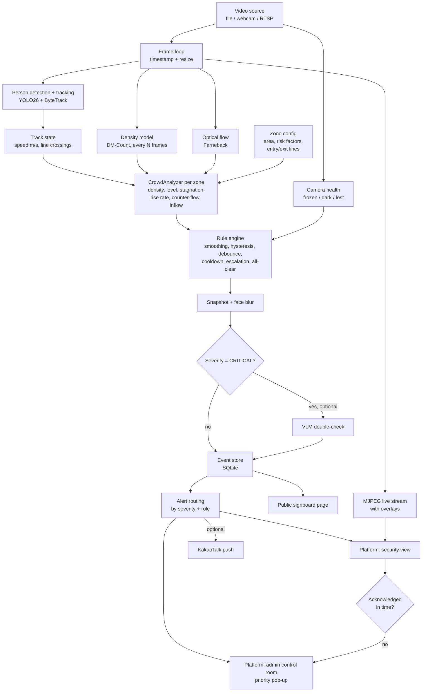

# Architecture — 숨터 Sumteo

One video-analytics engine with one goal: **prevent crowd crush (Itaewon-type disasters)**.
It watches not only *how many* people are in a zone, but *how the crowd behaves*: stuck, filling up fast,
pushing against itself. Those are the signals that turn a crowded street into a deadly one.

> Scope: crowd only. Bridge mode was split out (kept in `../bridge-safety-ai/`).
>
> Model: the district systems Seoul built after Itaewon (AI CCTV counting people per m², 4-tier levels,
> alerts mirrored to district / city / police / fire, priority camera pop-up, public signboards, slope and
> inflow data in the risk index). This project is an open, measurable version of that loop that runs on one laptop.

---

## 1. High-level flow



---

## 2. Layers

### 2.1 Video (`src/sumteo/video/`)
- `VideoSource` wraps OpenCV `VideoCapture` for file, webcam index or RTSP URL.
- Yields `Frame(image, ts, index)`. For files, `ts` comes from the frame index / FPS so results are reproducible.
- Optional `target_fps` frame skipping keeps processing real-time on a laptop.
- **Camera health** (`health.py` — `CameraHealth`): a dead camera at a hotspot is a silent failure, so it raises
  **one** `CAMERA_HEALTH` condition per camera (`zone_id` None, `details.problems` = list of `lost` / `frozen` / `dark`),
  so several problems at once give one event.
  - **frozen:** mean abs gray difference to the previous frame (downscaled) below `camera_health.frozen_diff_below`
    (0.5) for `frozen_seconds`
  - **dark:** mean gray below `dark_mean_below`
  - **lost** (live sources only — end of file is normal): `VideoSource` tries to reopen `reconnect_attempts` times,
    `camera_health.reconnect_wait_s` (1.0) apart; then it yields placeholder frames with `image=None` once per second
    and keeps retrying, so the loop and the engine keep running.
  - **while any problem is active** the pipeline skips perception **and** the analyzers: zones hold their last level
    and emit nothing until the feed is healthy again — in particular no `ALL_CLEAR`, because a dead camera must never
    announce "calm". The overlay shows "CAMERA: <problems> — zones hold their last level". (User decision: hold last
    level, not "unknown".)
- `overlay.py` — draws boxes, IDs, zones, lines, level colors and labels, flow arrows (toggle `f`), per-zone badges
  for active rule conditions, in / out counts per zone and a camera-health badge. Korean labels go through Pillow with the
  macOS AppleSDGothicNeo font (OpenCV can't draw Hangul); if the font is missing, labels fall back to English.
- **Demo tag:** when a camera overrides `crowd.levels_ppm2`, the metrics panel shows a red line
  "DEMO THRESHOLDS: yellow … / orange … / red … /m² (not the real levels)" with the values in use, so a demo can't be
  mistaken for real danger. `CameraConfig` keeps its `overrides` dict after merging so this can be detected.

### 2.2 Perception (`src/sumteo/perception/`)
| Module | Model | Output | Frequency |
|---|---|---|---|
| `detector.py` | YOLO26n/s (person class only) + ByteTrack | `list[Detection(track_id, bbox, conf)]` | every frame |
| `density.py` | DM-Count (authors' weights: SH-B default; SH-A / NWPU per camera) | density map + count | every N frames (≈1 fps) |
| `flow.py` | OpenCV Farneback optical flow | per-zone flow speed (m/s), turbulence, counter-flow | every `models.flow_every_n_frames` |

Detector settings live in config `models:` (`detector`, `detector_imgsz` 1280, `detector_conf` 0.1, `tracker`); tracker
thresholds live in `configs/bytetrack.yaml` (high 0.2, low 0.05, new track 0.3, buffer 30 frames = `tracking.lost_after_s`
at 15 fps, match 0.95). Why: in high, wide-angle shots people are small, so imgsz 640 finds almost nobody and stock
ByteTrack churns IDs. The low `detector_conf` only feeds ByteTrack's second-stage matching; a new track still needs ≥ 0.3,
so weak false boxes don't become tracks.

**Flow** (`flow.py`): Farneback on gray frames downscaled ×0.5. Flow → px/s → each grid point to a world velocity in
m/s through the homography. Per zone, points are **weighted by the density map** at that point, so empty ground doesn't
pull the speed to 0.
- `flow_speed` = weighted mean |v| (m/s)
- a point is *moving* when |v| ≥ `crowd.flow_moving_mps` (0.3, same as `still_speed_mps`)
- `turbulence` = 1 − |weighted mean unit vector| over moving points (0 = one direction, 1 = chaotic)
- `counter_flow` = weighted share of moving points more than 90° from the main (mean) direction
- both are 0 when nothing moves
- flow runs only on the zones' bounding box (`zones_roi`, 8 px margin), not the whole frame — on the 1080×2046
  crossing frame Farneback took 41 ms per run full-frame
- `CrowdAnalyzer` smooths all three like density (median over `smoothing_s`, §2.5)

**Why two counting methods?** Detection works well up to ~2–3 people/m². In dense crowds people
are occluded and detection under-counts badly, so the density model takes over.

**Switch rule** (per zone): the density model's own people/m² decides. Below `crowd.switch_density_ppm2` (**2.0**) the
zone uses the detection count; from 2.0 up it uses the density count. The default equals the YELLOW threshold (Day 4,
user decision; was 2.5) so the YELLOW decision never rests on the detection count, which under-counts wherever people
overlap (crowd_02: 13 vs 17, 14 vs 23). Detection saturates in crowds, so it can't be
the one that triggers the switch. Before the first density run, detection is used. At low density detection is the
better count (crowd_02 zone `main`, 148 m²: detection 13.4 people on average, DM-Count SH-B 11.4, SH-A 10.5).
**Top-down cameras** where YOLO finds almost nobody must set `crowd.switch_density_ppm2: 0` in their camera YAML
(always density). This is a real camera property, not a demo value: with the default switch (2.5 then, 2.0 now), `crossing_demo`
on real thresholds counts 0 people, because NWPU's 0.88 /m² is under it and detection finds ~1 person.
The held-out run confirmed it (§5): crowd_03 / crowd_04 were set up without camera properties, so they used detection
and counted 9 and 17 people against 65 and 63 by eye (−80%). Afterwards, as a diagnostic only, NWPU on the same frames
gave 72 and 56 (within ~11%; SH-A 51 / 35, SH-B 24 / 18).

**Density weights per camera:** the default `models.density` is `models/dmcount_shb.pth` (street scenes). Dense
cameras set `models.density: models/dmcount_sha.pth` in their camera YAML `overrides:` — on the dense Shibuya clip
(crowd_05) SH-B counts 44 and SH-A 322. Very high, top-down views with tiny people use `models/dmcount_nwpu.pth`
(`crossing_demo`: NWPU 154 vs ~150 by eye; SH-A 84–140, scale-sensitive). The pipeline sums the density map inside each zone mask.
DM-Count is MIT-licensed; its model is re-declared in `perception/density.py` and loads the authors' weights.

### 2.3 Geometry (`src/sumteo/geometry/`)
- `zones.py`
  - `Polygon` — crowd area, point-in-polygon. A camera can have **several zones**; each gets its own level.
  - `Line` — entry / exit counting lines (a segment); `side(pt)` tells which side a foot point is on. What counts as a
    crossing is in §2.5.
- `calibration.py` — homography from 4 clicked image points ↔ 4 real-world points (meters).
  Converts pixel positions to meters → speeds in m/s and zone areas in m².
  Without calibration, nothing in m² or m/s is meaningful, so every camera config has one.

### 2.4 Zone config (`configs/cameras/*.yaml`)
```yaml
zones:
  - id: alley
    polygon: [[x, y], ...]          # pixels
    risk: {slope: true, narrow: true, bottleneck: false}
    entry_line: [[x1, y1], [x2, y2]] # optional, for inflow counting
    exit_line:  [[x1, y1], [x2, y2]]
```
**Risk factors** (Seoul's risk index uses slope data for the same reason — the Itaewon alley was steep and narrow):
each flag multiplies the zone's level thresholds by a factor from `crowd.risk_factors`, never below
`crowd.risk_factor_floor`. Example: slope (0.85) × narrow (0.9) → a steep alley turns RED at ~3.8 instead of 5 people/m².

### 2.5 Analytics (`src/sumteo/analytics/`)

**`state.py` — TrackState** (per track ID)
- ring buffer of `(ts, foot_point_px, foot_point_m)`
- `speed_mps` (smoothed over last ~1 s), `still_seconds`
- `seconds_in_zone: dict[zone_id, seconds]` — a camera has several zones, so time is kept per zone
- line crossings for inflow counting: `last_side` keyed by line id `"<zone>:entry"` / `"<zone>:exit"` (+1 / -1)
- `TrackStore.update(ts, detections, homography, zones)` takes all of the camera's zones and returns this frame's new
  `Crossing(ts, line_id, track_id, direction, into_zone)` list; running totals in `TrackStore.crossing_counts[line_id][direction]`

**Crossing rule** — a raw side change between frames miscounts: a foot standing on the line jitters across it, and
someone walking past a line's end crosses its infinite extension. So:
- the side is judged on the track's **median foot position** (median x and y in metres) over the last
  `tracking.speed_window_s`, and only once the track has at least half a window of history (the same rule as speed).
  Why: a half-hidden person's box shrinks and the foot point jumps 0.5–1.5 m for one frame; near the far line
  1 px ≈ 10 cm, so the band alone doesn't absorb it (crowd_02: 36 → 14 crossings)
- a side is only registered once that median foot point is ≥ `tracking.line_band_m` (0.3 m, world metres) from the line;
  inside the band the last registered side is kept, so standing on the line never counts
- a crossing = the registered side flips **and** the median foot projects onto the segment between its two endpoints
- `direction` = the new side (+1 / -1)
- **into the zone** = toward the zone centre: on any of a zone's lines (entry or exit), a crossing whose new side holds
  the zone polygon's centroid (world metres) has `into_zone = True` (inflow); the other way is outflow
- **re-cross lockout:** after a track's registered side on a line changes, a further change on that line within
  `tracking.recross_lockout_s` (3.0) updates the side but isn't counted. Why: on crowd_02 every remaining re-count was
  the same ID re-crossing the same line 0.5–1.8 s later. A teleport guard was rejected — far-away foot jitter already
  gives normal tracks single-frame steps of 20+ m/s, so it can't tell these apart
- **OUT dwell** (Day 4, user decision): an OUT crossing (`into_zone` False) counts only if the track's registered side
  was the inside side for ≥ `tracking.out_dwell_s` (**2.5**, tuned) before it crossed; IN crossings are unchanged. Why:
  extra OUTs came from tracks first registered just inside the zone (people first seen after entering, fragments after
  an ID switch). Applied to OUT only, so the in ÷ out ratio errs slightly **high** — the early-warning side; a dwell on
  both directions would also drop real INs
  - tuned on crowd_02's moved line vs the user's count (IN 5, OUT 7–8): 1.5 s → IN 5 / OUT 10; 2.5 s → 5 / 8;
    3.5 s and 5 s → 5 / 6. One short clip (~13 crossings), so treat 2.5 as a starting value, not a settled one
  - the **re-cross lockout is applied before the dwell** — otherwise a blocked OUT let an ID-switch flip-flop count as
    an IN (gave IN 6)
- no calibration (homography `None`) → line counting is skipped, because the band is in metres; zone timers still work

**`crowd.py` — CrowdAnalyzer → `CrowdMetrics`** (one analyzer per zone, per second)
- `CrowdAnalyzer(cfg, zone_id, zone_area_m2, risk_factor)`;
  `update(ts, detection_count, density_count, median_speed_mps) → CrowdMetrics`; `conditions(metrics) → list[Condition]`
- `risk_factor(cfg, zone.risk)` = product of the flagged factors, floored at `risk_factor_floor`
- **zone speed follows the count source:** a zone counted by detection uses `median_speed_mps` (tracks); a zone counted
  by density uses `flow_speed` — from high up YOLO finds almost nobody, so track speed would read 0. Exposed as
  `CrowdMetrics.speed_mps`; `STAGNATION` uses it. No new threshold. A zone hovering at the switch flips the speed source
  every update; `STAGNATION` still fires after `stagnation_seconds` (unit-tested).
- **flow metrics are smoothed like density:** `flow_speed`, `turbulence` and `counter_flow` are each a median over
  `smoothing_s`. Why: raw turbulence on `crossing_demo` jumped 0.1 ↔ 0.85 second to second, so ORANGE + turbulence → RED
  flickered. Side effect: "moving again" resets the stagnation timer only after more than one smoothing window of
  movement — it errs toward warning.
- conditions carry `details.level`, so `STAGNATION` can map to CRITICAL at ≥ ORANGE

| Metric | How |
|---|---|
| `count` | hybrid detection / density |
| `density_ppm2` | count ÷ zone area (m²), **median over the last `smoothing_s`** |
| `flow_speed` | density-weighted mean optical-flow speed in the zone, m/s (§2.2) |
| `median_speed_mps` | median walking speed of tracks in the zone |
| `speed_mps` | `median_speed_mps` if the zone is counted by detection, `flow_speed` if by density |
| `turbulence` | 1 − \|weighted mean unit vector\| of moving flow points (0 = one direction, 1 = chaotic) |
| `counter_flow` | weighted share of moving flow points > 90° from the main direction |
| `rise_ppm2_per_min` | least-squares slope of the smoothed density over the last `rise_window_s`, × 60; only once the samples span ≥ `smoothing_s` (no start-up noise) |
| `inflow_per_min` / `outflow_per_min` | `into_zone` True / False crossings on the zone's lines in the last `inflow_window_s`, × 60 ÷ `inflow_window_s` — always the full window, so a short clip doesn't extrapolate a few early crossings |
| `level` | from thresholds below, with risk factors and hysteresis |

**Levels** — thresholds from crowd-safety literature (Fruin levels of service), labeled with the Korean national
crisis-level names so operators read them the way they already do:

| Level | Label | people/m² (default) | Meaning |
|---|---|---|---|
| GREEN | 관심 Attention | < 2 | free movement |
| YELLOW | 주의 Caution | 2 – 4 | dense, restricted movement |
| ORANGE | 경계 Alert | 4 – 5 | critical, bodies touching |
| RED | 심각 Serious | ≥ 5, or ORANGE with high turbulence | crush risk — act now |

> These numbers are *not* Seoul's official thresholds (those aren't published). They warn a little earlier than
> commonly quoted crush figures (5–6+), on purpose: the system exists to buy time.

**Hysteresis:** a level goes **up** at its threshold but only comes **down** when density falls `hysteresis_ppm2`
below it (e.g. ORANGE at 4.0, back to YELLOW under 3.6). This stops a crowd sitting at 3.95–4.05 from flipping every second.
A RED reached through turbulence doesn't change the stored base level that hysteresis works from.

### 2.6 Rules → conditions

The analyzer emits `Condition`s; the rule engine decides which become events.

| Event | Condition (all thresholds in config `crowd:`) | Severity |
|---|---|---|
| `CROWD_LEVEL` | emitted every update while level ≥ YELLOW (`details.level`); the engine turns it into one event per activation / severity change | YELLOW → INFO, ORANGE → WARNING, RED → CRITICAL |
| `STAGNATION` | level ≥ `stagnation_min_level` **and** `speed_mps` < `stagnation_speed_mps` for ≥ `stagnation_seconds` — the crowd is stuck (the Itaewon pattern) | WARNING; CRITICAL if level ≥ ORANGE |
| `DENSITY_RISING` | `rise_ppm2_per_min` > `rise_ppm2_per_min` threshold while density ≥ `rise_min_density` — **early warning** before ORANGE | WARNING |
| `COUNTER_FLOW` | `counter_flow` > `counter_flow_warn` while level ≥ YELLOW — two streams colliding | WARNING |
| `INFLOW_IMBALANCE` | `inflow_per_min` ≥ `inflow_min_per_min` and inflow ÷ outflow > `inflow_ratio` over `inflow_window_s` — the zone is filling | WARNING |
| `CAMERA_HEALTH` | feed lost / frozen / dark — one condition per camera, `details.problems` (§2.1). While active, that camera's zones hold their last level and emit no other conditions (no `ALL_CLEAR`) | WARNING |
| `ALL_CLEAR` | emitted while GREEN **and** no other condition is active for that zone (so a GREEN zone's `INFLOW_IMBALANCE` doesn't get an all-clear right after its own WARNING); the engine fires it only if that zone fired WARNING/CRITICAL since its last all-clear | INFO |

Conditions are emitted **continuously** while true; deciding what
becomes an event is the engine's job. Rules not listed with a severity mapping use `DEFAULT_SEVERITY`.

Turbulence is used only inside the RED escalation for now (hard to tune as its own rule on stock video).

> **Known limitation — outflow overcounts.** On crowd_02, outflow read ~40% high before Day 4 (by eye 7–8, system 11):
> tracks that start just inside the zone and walk out, and track fragments near the line. That biases inflow ÷ outflow
> **low**, so `INFLOW_IMBALANCE` may fire late or not at all — the unsafe direction for an early warning. The OUT dwell
> (§2.5) targets this (crowd_02 after tuning: OUT 8 vs 7–8 by eye); line placement matters too (DATA.md §2, *Counting lines*).

> **Known limitation — turbulence is tuned only on calm footage.** People in a square walk in all directions, so calm
> crowds already read high: smoothed, after the first window, crowd_02 median 0.59 / p95 0.74 and crowd_06 (real
> thresholds) median 0.61 / p95 0.72, max 0.75 on both. `turbulence_red` was raised 0.6 → **0.8** (Day 4), just above
> that calm ceiling — a margin of only 0.05. With 0.6, crossing_demo skipped ORANGE (0.67 events per change). Whether
> 0.8 catches real crowd turbulence is untested: no stock footage shows it. At other flow spacings it means something
> else: crossing_demo at 5 fps (0.2 s pairs) holds RED ~6 s past the density drop while the crowd clears (DATA.md §2).

> **Known limitation — density reads low on dense real CCTV.** On the crowd_07 held-out (§5, NWPU), the system counted
> about half the people (0.65 of the label at 71 people, 0.40 at 243), and the gap grows with the crowd. Every
> people/m² reading, the levels and the rise rate (people/m² per minute) are then low too — the **unsafe direction**: a
> real crowd would reach a level later than the system shows it. The shape over time holds (build-up and clearing are
> followed). Measured on one camera and 40 s; not corrected — a correction factor fitted on the held-out clip would
> turn it into tuning data, so any fix needs new footage.

### 2.7 Events (`src/sumteo/events/`)
- `models.py` — `Condition(type, zone_id, track_id, details)`, `Event(id, camera_id, type, severity, ts, zone_id, details, snapshot_path, verified, acknowledged)`
- `engine.py` — `RuleEngine`
  - **key**: `(zone or track, type)`, one engine per camera; a key fires **once per activation**
  - **debounce**: per severity — a condition (or a new severity of it) must hold `debounce_s` before it fires (kills flicker)
  - **escalation**: a higher severity fires immediately, even inside a cooldown
  - **de-escalation**: a drop in severity is silent but re-arms the key, so a later rise alerts again
  - **cooldown**: a key that stops and comes back within `cooldown_s` at the same or lower severity is blocked
  - **combine**: conditions firing for the same zone in the same `update` call go out as **one** event with the highest
    severity and `details.reasons` listing all types (e.g. CROWD_LEVEL RED + STAGNATION), not as separate alerts
  - **all-clear**: one `ALL_CLEAR` when the zone returns to GREEN, only if it fired WARNING/CRITICAL since the last one
    - no cooldown on `ALL_CLEAR` — the WARNING/CRITICAL gate is enough; with a cooldown, ORANGE → GREEN → ORANGE → GREEN
      inside `cooldown_s` swallowed the second all-clear and operators were never told the zone was calm
    - firing an `ALL_CLEAR` clears that zone's cooldowns: once declared calm, a new rise is a new situation and alerts,
      even within `cooldown_s` of the previous alert

### 2.8 Alert routing (`src/sumteo/events/notifiers/`)
Alerts live **in the platform**: the people on duty watch the dashboard, so that is where alerts appear first.
Like Seoul's system, which mirrors one alert to district, city, police and fire at once — but routed by severity
and role so each group only gets what it must act on. Routes live in config `notifiers.routes`:

| Severity | Goes to | Meaning |
|---|---|---|
| INFO | admin feed | log it |
| WARNING | + **security** view | on-site guards: check the zone, get ready |
| CRITICAL | + **admin** pop-up + optional KakaoTalk | control room: act now |

- **Roles:** `security` (on-site guards, phone or tablet) and `admin` (control room). The demo picks the role on a
  simple login screen; a real deployment needs proper accounts.
- **Getting noticed:** sound + browser notification (works when the tab is in the background) + priority pop-up.
- **Acknowledge:** an alert stays highlighted until someone acknowledges it; who and when is stored.
  **Acknowledge all** (Day 6, user: 90+ open alerts as admin): admin only, after a confirm dialog ("… their escalations
  stop. Check the map for any camera still RED first."); each id goes through the single-ack path (first ack wins,
  escalation cancelled, `ack` to every client). No guard for still-active CRITICALs and no replay auto-close (user,
  Day 6: "red is enough for alerts" — the map's RED pins stay the cue; the confirm dialog says to check them). Audit: `events.acknowledged_via` = `single` | `bulk` (NULL for acks
  from before the column), so a bulk ack never reads as individually reviewed.
- **Escalation** (`events/escalation.py` — `AckTracker`, API process, **wall clock** since acks are human time): any
  CRITICAL not acknowledged within `ack_timeout_s` is re-sent **once** to admin as an `escalation` message; the DB
  event's details get `escalated: "no response"` and `escalated_at`.
- **KakaoTalk (optional):** the messenger Koreans actually use. Demo: Kakao Developers "send to me" API with the
  operator's own token. Production: business channel + AlimTalk (알림톡). Sends text + a link to the event,
  not the photo, so snapshots stay on the platform.

- **Orders, control room → guards (Day 6, user decision "Camera on every alert + orders"):** the admin sends a short
  instruction tied to a camera (and optionally a zone / event); guards answer with their status.
  - `text_key` from a fixed bilingual list (`dashboard/lib/i18n.ts`): `go_to_camera` ("Go to this camera's area"),
    `redirect_exit` ("Redirect people to another exit"), `stop_entry` ("Stop people entering"), `open_lane` ("Open a
    one-way lane"), `clear_blockage` ("Clear the blockage"); plus an optional note (≤ 140 characters).
  - Status `sent` → `on_my_way` → `done`; only `admin` sends (403 otherwise), only `security` moves the status, forward
    only (409 on a backward step; `sent` → `done` is allowed). `text_key` outside the list or a longer note → 400.
    `by_role` is the role of the latest step. Each step's wall time is
    stored (`created_at`, `on_my_way_at`, `done_at`) with the role, like acks. The role comes from the demo role pick —
    real accounts are backlog (§2.12).
  - Orders are human actions: never recorded or replayed, never used for measured numbers. Escalation stays alerts-only.
  - Guards see only blurred frames and snapshots, the same as admin (§2.10).

Notifiers: `console`, `platform`, `kakao`. `PlatformNotifier` runs in the camera worker and only forwards the event to
the API process; role routing (`notifiers.routes`, roles `security` / `admin`) happens there.

### 2.9 Verification (`src/sumteo/verify/vlm.py`) — optional
For CRITICAL events only, send the **face-blurred** snapshot to a vision LLM:
"Is this crowd dangerously dense or pushing? Answer yes/no + reason."
Used to *annotate* the alert (never to suppress a CRITICAL alert silently — a human always sees it).

### 2.10 Privacy (`src/sumteo/privacy/blur.py`)
- Face **detection** only (to blur), never face **recognition**. No identities are stored.
- **What is blurred:** faces **and** heads.
  - YuNet (OpenCV `FaceDetectorYN`, MIT, ~230 KB onnx in `models/`) finds close faces. It runs at half size
    (crowd_02 32 → 8 ms, crossing 76 → 19 ms); the small faces this loses already get the head band, and what only
    YuNet catches are large, close faces of people YOLO misses.
  - The top `privacy.head_fraction` (0.2) of every YOLO person box is blurred too: in high shots faces are 5–15 px,
    too small for any face detector.
  - **Cameras with a density-counted zone** (user decisions): YOLO finds only a fraction of people there (~1 in 4 on
    crossing_demo), so the **whole frame** gets a soft Gaussian — people outside the zone too. Sigma = half a head,
    head = `privacy.head_size_m` (0.25) converted to px at each density-counted zone's centre via the homography; the
    largest of those sigmas is used (crossing_demo ~3.8 px). Faces are gone; the crowd's shape stays visible.
  - **Box blur** (faces, head bands) is a fixed-cost anonymize, not a Gaussian: shrink the padded box to 6 px across
    (`INTER_AREA`), scale back up (`INTER_LINEAR`). Why: large boxes (big padded head bands / face boxes) made huge Gaussian kernels (crossing_demo fell to
    2.3 FPS); no detail survives 6 px, so privacy is the same or stronger.
  - The masked blur uses `cv2.copyTo`, not numpy boolean indexing (full frame 6.6 ms).
  - **Known limitation:** on detection-counted cameras (crowd_02), people the tracker never picks up (far background,
    faces ~4 px) are not blurred — the head band only covers tracked boxes. Not identifiable at that size, but no
    rule covers them.
  - On a frozen feed the frame is blurred with the last known boxes.
- **Where:** right after perception, before the overlay, whenever `privacy.blur_faces` is on. Detection, density and
  flow see the raw frame. Order inside `FaceBlur.apply`: YuNet on the **raw** frame (half size) → soft frame / zone
  blur → anonymize over faces + head bands. Everything downstream — window, `--save` video, snapshots, the Day 5 MJPEG stream — gets the
  blurred one. Overlay text stays sharp on top.
- **Snapshot:** on each event, the blurred frame with its overlay is saved as JPEG to
  `events.snapshot_dir/<event id>.jpg` and `event.snapshot_path` is set.
- Snapshots are blurred before they are saved, shown on the platform or sent to a VLM. KakaoTalk gets a link, not the photo.
- Raw video is not stored by default — only event snapshots.

### 2.11 Storage and API
- `storage/db.py` — SQLite tables: `events`, `crowd_metrics` (1 row per zone per second), `orders` (id, camera_id,
  zone_id, event_id, text_key, note, status, created_at, on_my_way_at, done_at, by_role).
  `Storage(path)` with `add_event(event)` and `add_metrics(camera_id, metrics)`; the pipeline writes `crowd_metrics` once
  per zone per second (when `int(ts)` changes) and every event as it fires. While the camera has a health problem no
  `crowd_metrics` rows are written — an honest gap, not stale rows.
- `Pipeline.run(on_frame=None)` — per-frame callback `(ts, metrics, events)`, used by `eval_crowd.py` and the Day 5 API.
- **Two clocks:** `Event.ts` and `crowd_metrics.ts` stay the video clock; `Event.created_at` / `events.created_at` and
  `crowd_metrics.wall_ts` are wall-clock epoch seconds (latency, acks, `?since=`).
- `api/server.py` — FastAPI (`create_app()`, started by `scripts/serve.py --cameras a.yaml b.yaml`)
  | Endpoint | Purpose |
  |---|---|
  | `GET /cameras` | `[{id, name, health: [problems], demo: {overridden, levels}, location: {lat, lon, label, clip} \| null, zones: [{id, area_m2, level, label, density_ppm2, count, count_source, speed_mps, active: [condition types], thresholds: {yellow, orange, red}}]}]` — zone thresholds include the risk factor; `demo.overridden` = the camera overrides `crowd.levels_ppm2` |
  | `GET /cameras/{id}/stream` | MJPEG with overlays (blurred frames), scaled to 960 px wide, 15 fps |
  | `GET /cameras/{id}/frame.jpg` | the latest processed frame — the same blurred + overlaid JPEG as the stream (960 px wide, ~90–150 KB); `Cache-Control: no-store`; 404 for an unknown camera or before the first frame. Why: browsers allow ~6 connections per host and each MJPEG holds one, so only the camera card and enlarged view stream; thumbnails poll this every 2 s |
  | `GET /events?camera=&severity=` | event history |
  | `GET /events/{id}` | one event |
  | `POST /events/ack` | body `{role: "admin", ids: [...]}` — bulk ack, admin only (403), ≤ 500 ids (400), duplicates / unknown ids skipped; returns the updated rows |
  | `POST /events/{id}/ack` | body `{role}`; the **first ack wins**; stores `acknowledged_by`, `acknowledged_ts` (wall) |
  | `GET /metrics/{camera}?since=` | crowd density time series; `since` in wall-clock epoch s |
  | `GET /snapshots/<id>.jpg` | static, blurred event snapshots |
  | `POST /orders` | body `{camera_id, zone_id?, event_id?, text_key, note?, role: "admin"}` — admin only; stored with status `sent` (§2.8) |
  | `POST /orders/{id}/status` | body `{status: "on_my_way" \| "done", role: "security"}` — forward only, stores the step's wall time |
  | `GET /orders?camera=&status=` | order history |
  | `GET /signboard/{zone}` | `{zone, camera, place, level, label, message_ko, message_en, demo, replay}` (`signboard_view()`); the page shows the place, the DEMO and "REPLAY — recorded run · 재생" lines, and "Unknown zone" on 404; `/admin` camera cards link each zone's signboard |
  | `WS /ws?role=security\|admin` | `hello` (all camera states + `open`: unacknowledged WARNING / CRITICAL events routed to that role since the server started — `Storage.open_alerts`), `camera` (one state, every second, all roles), `event` (routed by role), `ack` (all roles), `escalation` (admin), `order` (security), `order_update` (all roles) |


**Replay mode (Day 6, user decision)** — this laptop (M3, 8 GB) can't run four cameras live (§4), so the demo plays
**recorded runs** of the real pipeline, plus optionally one live camera.
- **Record** — `scripts/record_camera.py --camera X.yaml --out data/recordings/<camera_id>/`: the same `Pipeline` at the
  same settings, **one camera at a time**, on the laptop or on Google Colab (GPU; notebook `notebooks/record_colab.ipynb`,
  committed without outputs). It writes only:
  - `video.mp4` — the blurred + overlaid frames exactly as the stream shows them (960 px wide, the camera's `target_fps`)
  - `timeline.jsonl` — video-clock ordered: one `camera` state per second (the WS message) and every `Event` as fired
  - `snapshots/` — the blurred event snapshots
  - `manifest.json` — camera id, sha256 of the merged camera config, git commit, device (`cuda` / `mps` / `cpu`),
    clip duration
  **Config hash** (`config.config_hash()`) = sha256 of the camera plus `runtime`, `models`, `tracking`, `crowd`,
  `camera_health`, `events`, `privacy`, `verify` — **minus** where/how a run happens: `runtime.device`, `show_window`,
  `save_path`, `loop`, `events.snapshot_dir`. Run-only sections are left out: `storage`, `api`, `notifiers`,
  `city_data`. Everything that changes what is computed counts (thresholds, models, `target_fps`, calibration, zones,
  source); paths are repo-relative, so the same clip on
  Colab and the Mac hashes the same. The state lines are written with the API's `camera_state()`, so a recording holds
  exactly what the WebSocket sends.
  **Inputs:** `manifest.json` also holds `inputs` — the sha256 of `models.detector`, `models.density`, the camera source
  and, when blur is on, `models.face_detector`. A replay refuses to start when a file at the same path exists here with a
  different sha256 ("recording is stale, re-record (different file at …)"), so the same path can't hide different weights
  or a different clip. Files missing here are skipped, which is what the replay-only Docker image needs (no weights or clips).
  The replay path is import-light: torch and ultralytics load only in the live worker (`camera_main`).
  Raw frames and identities are never stored (§2.10). Recordings live in `data/recordings/` (git-ignored) and are **not
  published** (user decision, Day 6): anyone running the demo records them first, on Colab or locally. A recording of
  crowd_07 is CroHD-derived, so CC BY-NC-SA 3.0 (DATA.md §2).
- **Record = the solo test:** a camera's recording run is its on-its-own test (pipeline + levels + alerts, §2.12); a
  camera joins the dashboard only with a recording that passed.
- **Replay** — `serve.py --cameras <live.yaml …> --replay data/recordings/<id> …` (at least one of the two; a camera
  can't be both live and replayed): a replay worker per recording (`api/replay.py`) loads **no models**; it plays `video.mp4` and `timeline.jsonl` paced by the wall clock at real speed, into the same queue →
  Hub → WebSocket path as a live worker. Looping as for file sources: the video clock keeps counting across loops.
- **Repeat limit (Day 6, user: "show RED / alerts less"):** a looping replay would re-emit every recorded event each
  loop (~4 pop-ups per 40 s on the crossing), more than a live camera, which `cooldown_s` holds back. `replay.repeat_alerts_s`
  (default 180, top-level `replay:` in `configs/default.yaml`) mirrors the rule engine's cooldown: per (zone, type), on
  the video clock, an event within that time is held back **unless it comes at a higher severity** — so a returning
  YELLOW → ORANGE → RED sequence still plays out whole. The first loop emits all; video and states keep looping. A
  run-only setting, outside the config hash.
- **Same platform path:** replayed events are stored in SQLite with a new id and `created_at` = now, routed by role,
  pop up, need an ack and escalate after `ack_timeout_s` exactly like live ones. Each loop re-emits the recorded events:
  new id, `created_at` = now, `ts` = recorded ts + loop offset, `replay` = 1; the snapshot is copied to
  `<snapshot_dir>/<new id>.jpg`. One `crowd_metrics` row per zone per recorded second (video ts continued, `wall_ts` now,
  `replay` = 1) keeps the density chart working; the `replay` column is added to old databases on connect.
- **Honesty:**
  - `/cameras` gets `mode: "live" | "replay"`; every view of a replayed camera (pin, card, video, event rows) carries a
    "REPLAY — recorded run" tag next to the DEMO tag (§2.12). A replay is never presented as live inference.
  - events and `crowd_metrics` get `replay` (0/1, a column, default 0); replayed rows and runs are never used for measured numbers (latency, FPS,
    accuracy) — `docs/results.md` numbers come from live or offline-evaluation runs only.
  - the replay worker refuses to start when the manifest's config hash differs from the current camera config (clear
    error: "recording is stale, re-record"), so a replay never shows outdated settings silently.
  - a recording made on Colab says so (`device: cuda`); its numbers can differ slightly from the Mac (MPS).
- **Live camera (optional):** `crowd_demo` (lightest, 20.4 FPS alone) runs live to show the live path; with no live
  camera the laptop runs no models at all.

### 2.12 Dashboard (`dashboard/`, Next 16, React 19, Tailwind 4, Recharts)
Routes: `/` (role pick), `/admin`, `/security`, `/signboard/<zone>`.
**Landing page `/` (Day 6, user decisions):** tells why Sumteo exists — the Itaewon story with cited facts and licensed
after-photos (rules in DATA.md §2, *Real disasters*), then "how Sumteo addresses it": each failure mapped to a feature
(no one measured density → people/m² per zone; late, unescalated warnings → four levels, rising / stagnation /
counter-flow alerts, escalation after 60 s; control room and street not connected → orders with the camera view;
privacy → face blur) and a limits line (prototype; on dense real CCTV it counts about half the people). The top demo
strip is removed; "demo positions, stock and research footage" stays visible in the live-status block and the footer.
Animations (scroll reveals, transform / opacity, short staggers, generic density diagram, pipeline pulse) are off under
`prefers-reduced-motion` and never on the tragedy facts. As built: one memorial photo (Commons, CC BY-SA, credited
under it; the post-it photo was dropped — legible political messages) and Seoul's AI CCTV view (KOGL Type 4, whole);
the density illustration is a generic 10 × 4 m zone at 1 / 2 / 4 / 5 / 6 people/m² by the real thresholds, marked
"illustration, not footage"; every fact links to a numbered source list on the page. A light public-service portal look with **our own** branding (Sumteo 숨터,
own wave mark) — no real agency name, emblem or layout copied, so it can't pass as an official service. Live status from `/cameras` + `/events` (cameras, open alerts,
live / replay); two role cards (Control room / Field guard); info cards (privacy, crowd levels, footage); footer:
Fruin research thresholds, not official Seoul figures; no 2022 footage; "Not an official government service" and the
demo-positions sentence (kept on purpose: a real Itaewon story in a portal look must not read as a real Seoul system);
no role-pick note (user); credits for CroHD (CC BY-NC-SA 3.0), Pexels and Kakao Maps.
- Camera grid with live MJPEG, zone overlays and level labels (color + 관심/주의/경계/심각) — Day 5; on `/admin` replaced by
  the v2 map (below)
- **Priority pop-up:** when a camera hits ORANGE/RED its feed jumps to a large view at the top with a sound,
  until acknowledged (Seoul control rooms do the same)
- Two views: **security** (my zones, big alert cards, Acknowledge — works on a phone) and **admin** (all cameras, pop-ups, history)
- Alert feed (color by severity, "Acknowledge" button, escalation mark), camera-health badges
- **Pop-ups** (admin modal, security cards) are for WARNING / CRITICAL that arrive live **and** for the open
  (unacknowledged) ones in `hello`, so a reload, a reconnecting phone or a new admin gets every open alert back as a
  pop-up with sound. Older history only fills the feed.
  - **User decision (Day 5):** "open" = unacknowledged WARNING / CRITICAL **since the server started**. Trade-off: after a
    server restart, alerts left open from before it are still in the feed but don't pop up or sound — so an operator
    restarting during an incident must check the feed by hand.
  An ack from either role closes the alert for both.
- **Sound:** Web Audio beeps, unlocked by the login click, or by a "tap to turn on sound" bar after a reload (browsers
  block audio until the user interacts). **Browser notifications** with `requireInteraction` on CRITICAL.
- Crowd density chart per zone with level bands
- Event detail: blurred snapshot, rules that fired, VLM note
- **Demo tag:** every view that shows a camera's level carries the same red "DEMO THRESHOLDS … (not the real levels)"
  line as the overlay (§2.1) when that camera overrides `crowd.levels_ppm2`
- **Replay tag:** every view of a replayed camera carries "REPLAY — recorded run" (§2.11, *Replay mode*); only live
  cameras show "live". Header status (`/admin`, `/security`): no live camera → "Connected · REPLAY" (grey); some →
  "Live N · REPLAY M"; all → "Live" (green); disconnected → "Reconnecting…"
- **Public signboard page** (extra): full-screen level + short instruction in Korean and English
  (e.g. "Crowded — use exit B →"), the way district signboards guide people away from a jam

**Dashboard v2 — map-first `/admin` (Day 6, user decisions)** — replaces the Day 5 camera grid on `/admin`; `/security`,
`/signboard` and the role pick are unchanged. The Qalqon-style three-column control wall and the Stitch mockups were
rejected. References: Seoul's real-time city data map (data.seoul.go.kr/SeoulRtd/map) and floating-panel map dashboards.
- **Location:** the demo map and the simulated camera positions sit around Itaewon Station (Yongsan-gu). Footage is
  still from elsewhere (stock clips, and CroHD HT21-03 for crossing_demo); every camera is labeled "stock clip (<source>), demo position". See DATA.md §2 for the
  rule on using the location.
- **Maps:** Kakao Maps JS SDK (user decision; replaced Naver). The JavaScript key from the user's Kakao Developers app
  goes in `dashboard/.env.local` as `NEXT_PUBLIC_KAKAO_MAP_KEY` — public by design, so it is domain-restricted in Kakao
  Developers to `localhost:3000`, `127.0.0.1:3000` and later the real domain. The map sits behind one component, so the
  provider can be swapped in one place.
  Each camera's position lives in its camera YAML: `location: {lat, lon, label, clip}` (`clip` = the stock source shown on
  the card).
- **Layout:** the Kakao map of Itaewon fills the screen (base tiles muted with a CSS filter — Kakao has no map styles);
  light cards float on top.
  - **header:** Sumteo 숨터 · Crowd Safety Monitor · Itaewon, Yongsan-gu | live dot, KST clock, EN | 한국어
  - **left card:** event list, filters All / Open / Critical / Warning, Acknowledge per row, NO RESPONSE mark. Clicking a
    row moves the map to the camera, opens its card and the event detail (blurred snapshot + all stored details)
  - **camera pins** (from the YAML `location`; Day 6, user decision): a CCTV icon (Lucide `cctv`, ISC) in a white badge
    whose border is the level color, with a ring pulsing out faster as the level rises (GREEN / YELLOW 2.6 s, ORANGE
    1.5 s, RED 0.9 s + glow; off under `prefers-reduced-motion`); the same pins on the `/security` mini maps.
    Text cue for colour-blind users: the visible label keeps the density, and title / aria-label read "label · level ·
    density · REPLAY". Pins stack by level (RED on top, the selected pin above all), so a label never hides an urgent pin;
    the map opens on the four cameras' midpoint at Kakao level 4, so all pins stay on screen with the main card open. First click → card under the
    pin: blurred live MJPEG, density / people / speed per zone, active rules, clip source, DEMO thresholds line, Enlarge
    and Acknowledge. Second click → enlarged view
  - **right card:** small Seoul map with the Itaewon area ringed; KPI tiles (cameras online, open alerts, peak density,
    people now); camera thumbnails (a still frame every 2 s, click to select); density chart for the last 5 min of the
    selected or worst camera
  - **bottom:** level legend (names only — thresholds are per camera and shown on its card) and a one-line ticker with
    the latest alert + "N cameras online (K live, M replay) · stock clips at demo positions"
  - **dropped:** tabs, search, role label, donut charts, alerts-per-hour, separate live camera grid (thumbnails cover it)
  - **unchanged:** pop-up until acknowledged, sound, escalation, open = since server start (§2.8, above)
- **Languages:** English first, Korean second (EN | 한국어); one dictionary in `dashboard/lib/i18n.ts`; the choice is
  remembered per browser. Level labels keep both forms (e.g. 주의 Caution).
- **Look:** page `#EEF1F4`, white cards, border `#D5DBE3`, text `#1B2430`, accent `#1D4F91`, IBM Plex Sans. Level colors are
  unchanged (`LEVEL_COLOR`, the same as the video overlay).
- **Cameras:** four, at the alley entrance on Itaewon-ro and on the nearest busy streets — none inside the alley; the
  alley-entrance camera runs a real-threshold clip so a demo RED never shows there (user decision, DATA.md §2):

  | Camera | Position (lat, lon) | Label | Thresholds |
  |---|---|---|---|
  | test_crowd_03 | 37.53452, 126.99345 | Itaewon-ro at Exit 1 (alley entrance) | real, stays GREEN — first recording read 0.01–0.04 /m² against ~0.24 by eye (high-view under-count, §2.2); re-recorded with NWPU + switch 0 (Day 6) |
  | test_crowd_04 | 37.53500, 126.99250 | World Food Street (~90 m west of the alley's north end) | real |
  | crossing_demo | 37.53436, 126.99625 | Itaewon-ro east | **demo** (0.17 / 0.34 / 0.425, crowd_07) — the demo RED |
  | crowd_demo | 37.53300, 126.99445 | Bogwang-ro | **demo** (1.0 / 2.0 / 3.0) |

  crossing_demo's clip is crowd_07 (CroHD HT21-03, CC BY-NC-SA 3.0, credited on screen and in the README; DATA.md §2),
  replacing crowd_06 on Day 6. Roads confirmed by OSM reverse-geocode. Earlier pins were wrong: "Usadan-ro" sat north of Itaewon-ro and the
  "Bogwang-ro" point was on Usadan-ro; Usadan-ro is dropped, and so is a fifth camera (crowd_01). **Each camera is tested on its own first** (pipeline +
  levels + alerts) and joins the dashboard only after it passes. Heavy clips may be compressed, downscaled or swapped
  for lighter stock clips to keep the laptop cool.
- **Main camera:** `api.main_camera` in `configs/default.yaml` (Day 6: `crowd-demo-1`, Bogwang-ro — user: the
  crossing looks poor under the whole-frame soft blur, which stays, §2.10). `GET /cameras` marks it `main: true`. `/admin`:
  first in thumbnails, its card open on load, the density chart's default. `/security`: shown large at the
  top. The crossing stays the demo-RED camera.
- **`/security` v2 (Day 6, user decision):** every alert card shows the blurred camera (`frame.jpg` every 2 s — phone-
  friendly, not MJPEG), the event's blurred snapshot, a small Kakao map with the pin, level, reasons and the REPLAY / DEMO
  tags. "Acknowledge" reads **"On my way"** for security (same ack: first wins, closes it for both roles). Orders (§2.8)
  show as cards with the same camera view and the order text, buttons "On my way" → "Done". `/admin` shows each order's
  status on the camera card and event detail, with "Send order to guards" there.
- **Later (after Day 6):** deploy on a bought domain with access limited to selected people — needs its own design
  (auth in front of the API, dashboard and MJPEG) before it's built.

### 2.13 City context (extra)
Seoul's real-time city data (data.seoul.go.kr, free API key) gives a 4-level congestion label for ~120 hotspots,
estimated from mobile signals, updated every 5 min with ~15 min delay. Shown next to our live level as the
"wider area" view: our camera is precise and second-by-second, the city data is broad and slow.
- **Built (Day 6):** `city/seoul.py` — `parse()` reads `citydata_ppltn` (`AREA_CONGEST_LVL` 여유 / 보통 / 약간 붐빔 / 붐빔 →
  Relaxed / Normal / Slightly crowded / Crowded, message, `AREA_PPLTN_MIN/MAX`, `PPLTN_TIME`); `CityData` polls every
  `city_data.poll_seconds` (300) in the API process, only with `city_data.enabled`, `SEOUL_API_KEY` (`.env`, read by
  `serve.py`) and an `area` (default `이태원 관광특구`). A failed poll keeps the last good answer, marked with the error
  type; errors never include the request URL (it holds the key). Outside the config hash.
- `GET /city` → `{status: off | waiting | ok | error, area, level_ko, level_en, message, people_min, people_max,
  measured_at, fetched_at, error}`.
- `/admin`: a separate panel under the Seoul mini-map — area, label, min–max people, time, and "mobile-signal estimate
  for the whole area · every 5 min, ~15 min late"; **no level colours**, so it is never read as our level. Without a
  key: "City data off — add SEOUL_API_KEY to .env".

---

## 3. Process model

```
scripts/serve.py --cameras a.yaml b.yaml      (uvicorn; create_app() spawns the workers)
   ├─ replay worker process × M (`--replay`, no models): video.mp4 + timeline.jsonl at wall-clock speed → same queues
   ├─ camera worker process × N (multiprocessing spawn): frame loop → perception → blur → analyzer → rule engine
   │     → SQLite + snapshots (written by the worker) ; queue → API:  frame (JPEG, put_nowait — dropped when full)
   │       · state (1/s) and event (`put_reliably()`: 5 s put timeout, a loud log line every 5 s while the API isn't
   │         reading, keeps retrying — never dropped, never silent)
   └─ API process: one reader thread per camera queue → Hub (api/hub.py, in-memory pub/sub) → WebSocket clients
         + MJPEG; reads SQLite and writes acks through its own connection; AckTracker (escalation)
dashboard (`next build && next start` for the demo — `next dev` recompiles and costs the laptop more)
   └─ talks to the API only
run_camera.py --camera …                       (single camera, local window, no API)
record_camera.py --camera … --out …           (one camera, offline, laptop or Colab → data/recordings/<id>/)
docker compose up                             (replay-only demo: API + dashboard, no models — Docker on a Mac has no MPS)
   ├─ api: python:3.12-slim, no torch / ultralytics, opencv-headless; `serve.py --host 0.0.0.0` inside, published on
   │       127.0.0.1:8000; ./data/recordings mounted read-only; own SQLite + snapshots in the volume `sumteo-data`
   └─ dashboard: `npm ci && next build`, `next start`, 127.0.0.1:3000; the Kakao key is baked in at build time from
           dashboard/.env.local, so the image is never pushed to a public registry
```
**Why processes, not threads** (measured, Day 5): two cameras as threads in the API ran 4.9 + 3.2 FPS — the
Python-heavy parts serialize on the GIL; as processes 8.8 + 4.1 FPS (alone 14.9 / 6.6; the shared GPU is the remaining
cost). File sources loop for the demo (`runtime.loop`, set by the server); the video clock keeps counting across loops.
Swap the queues + Hub for Redis only if cameras run on several machines.
**Shutdown:** MJPEG streams never end, so `serve.py` gives uvicorn `timeout_graceful_shutdown=3`; after 3 s the lifespan
cleanup still runs and terminates the workers (Day 6: without it, a force-kill left orphaned workers).

---

## 4. Performance targets (MacBook M-series, 720p input)

| Item | Target |
|---|---|
| Detection + tracking (YOLO26n, 1280) | ≥ 15 FPS (measured 17–28 FPS on the Day 1 clips) |
| Density model | ~1 run/s |
| Full pipeline (Day 3, MPS) | measured: crowd_02 15.6 FPS; crossing_demo 8.6 FPS — density (928 ms/run, every 15 frames) is the main cost |
| Full pipeline + blur (Day 4) | measured: crowd_02 14.9 FPS; crossing_demo 6.6 FPS (without blur 16.5 / 8.6) |
| Full pipeline + blur, crossing_demo on crowd_07 (Day 6, 1080p, dense) | measured: ~2.0 FPS processed (600 of 1000 frames at `target_fps` 15, 302 s for a 40 s clip) — far under target. Stage times on 60 dense frames: YOLO + track 99.8 ms (39%, letterboxed to 1280 at any clip size), density 90.5 ms amortized (35%, NWPU on the full 1920×1080 frame, ~1.36 s per call every 15 frames), blur 30.9, flow 17.4, overlay 16.9, tracks 0.8 → 256 ms = 3.9 FPS on the stages alone; warm-up, snapshots, storage and delivery make up the rest. File sources keep every `fps / target_fps`-th frame and never drop frames to keep wall time (live feeds do), so a slow camera stretches the clip: at 2–4 FPS the 40 s clip takes ~2.5–5 min on the dashboard and the demo RED (video 14.5 s) appears 1–2 min in; events stay correct in video time. A real-time demo needs this camera's sustained FPS ≥ its own `target_fps`. **Chosen (user, Day 6):** this camera alone runs at `target_fps` 5, flow every frame, density every 10 frames (DATA.md §2) — sustained speed to be measured with all 4 cameras; a move to 720p is agreed with the user first, calibration scaled ×2/3, held-out result stays as measured at 1080p |
| 4 cameras in one `serve.py` (Day 6, Apple M3, 8 GB) | measured: crossing_demo 0.06× real time (1 video-s per 16.6 wall-s), the others < 2 metric rows in 60 s; YOLO NMS time limit exceeded; no events, no camera-health alerts. Models only, each camera alone, after warm-up: test_crowd_03 8.4 FPS (needs 15), test_crowd_04 12.6 (15), crowd_demo 20.4 (15), crossing_demo 9.5 (5) → ~4.3 s of model time per wall second, > 4× this GPU, plus 4 model copies swapping in 8 GB. Capacity, not a broken camera. **Chosen (user, Day 6): replay mode** (§2.11) — each camera recorded alone, the demo plays the recordings, at most one live camera. Docker on a Mac has no MPS, so `docker compose` runs the replay-only demo |
| Alert latency (level change → dashboard) | < 3 s + debounce — measured Day 5 (two cameras, `serve.py`): rule firing (`created_at`) → WS client 0.08–1.5 s, both roles; a CRITICAL 0.34 s |
| Ack → alert closed for both roles | measured Day 5: within 2 s |
| Unacked CRITICAL → escalation | measured Day 5: re-sent to admin at exactly `ack_timeout_s` (60 s); acked CRITICALs not escalated |

---

## 5. Evaluation

| What | Dataset | Metric |
|---|---|---|
| Crowd counting | ShanghaiTech Part B test | MAE, RMSE |
| Dense crowd counting | ShanghaiTech Part A test | MAE, RMSE |
| Crowd levels | Pexels crowd videos (manual people counts per window → level) | level accuracy, off by > 1 level, count MAE |
| Alerts | labeled crowd videos | events per level change, false alarms per hour, time-to-alert |
| Rules (stagnation, rise, inflow, …) | **unit tests with fake metric sequences** | fires when it should, quiet when it shouldn't |

**Ground truth (Day 4, user decision):** people are counted by eye in each zone, on zoomed grid cells of the window's
midpoint frame, without looking at the system's output. The developer agent counts; the user spot-checks the densest
frames. Label level = count ÷ zone area, by the thresholds the run uses (real for crowd_02/03/04; the camera's demo
thresholds for crossing_demo, marked as demo). Windows are 10 s; crowd_06 gets 2 s so time-to-alert has usable resolution.
Because labels and system share the zone area, the level check tests **counting**, not the calibration (±20% area).
**Label noise ≈ ±15%:** the user counted 3 frames independently, before seeing the labels — crowd_02 15 s: 20 vs agent 23;
crowd_06 15 s: 78 vs 69; crowd_04 5 s (held-out): 58 vs 63. Differences of 8–15% go both ways, so no clear bias in
these 3 checks (too few to rule one out). Labels are kept as first counted, not swapped. A count-MAE difference
smaller than ~15% of the count can't be told apart from label noise.

**Split:** tuning = crowd_02 + crowd_06; held-out = crowd_03 + crowd_04 (`test_crowd_03.yaml`, `test_crowd_04.yaml`, real
thresholds, no overrides), run **once** after tuning. crowd_05 stays out (moving view). crowd_06 was removed on Day 6 (replaced by crowd_07); the
numbers above stand as measured. Tuned on 02 + 06 only:
`out_dwell_s` (→ 2.5) and `turbulence_red` (→ 0.8, above the calm ceiling of 0.75; §2.5, §2.6). Level thresholds stay Fruin —
stock footage can't tune ORANGE/RED.

**Held-out result (Day 4, run once):** one 10 s window per clip (clips are 10 s and 12.9 s). Level 2 / 2 GREEN — trivial;
count MAE 51.0 (system 9 / 17 vs 65 / 63 by eye, about −80%); 0 false alarms in 23 s. The failure is the camera setup,
not the model: from this height detection finds 1 in 4–7 people, and the switch rule kept detection below 2.5 /m² (the default then; at 2.0 the result is the same — SH-B read 0.07–0.09 /m²)
(§2.2). The result stands as measured; the held-out set is **not** re-run with fixed configs — that would turn it into
tuning data. A fix applies to the next camera. **Day 6 (user decision):** for the demo recordings only, test_crowd_03 / 04
get the camera properties (NWPU + switch 0; real thresholds, no DEMO tag) and are re-recorded; the held-out numbers
above stay as measured with the Day 4 config, and the new recordings are not an evaluation.

**Held-out on real CCTV — crowd_07 (Day 6, user decision "Run once, held-out"):** the protocol is fixed before anything
runs, and nothing is changed after.
- **Run:** `eval_crowd.py --levels --labels data/processed/crowd_levels.csv --cameras configs/cameras/crossing_demo.yaml`,
  without `--demo`: the demo-only overrides are dropped, real thresholds. Camera properties stay (NWPU weights,
  `switch_density_ppm2` 0) — the setup the Day 4 held-out finding called for. Calibration and zone (223.7 m²) as in
  DATA.md §2, **frozen from now on**: the demo-threshold tuning run on the same clip may change only the demo-only
  overrides, and its counts are not compared with the ground truth.
- **Windows:** 8 × 5 s over the 40 s clip, so the build-up and the clearing are resolved; system count and level at
  each window's midpoint frame.
- **Label count:** CroHD ground-truth head boxes at the same midpoint frame (MOT frame = mid_s × 25 + 1), only rows the
  MOT format marks as counted, kept when the foot point is inside the zone polygon. Foot point = head-box centre
  lowered by 1.50 m (a ~1.62 m mixed adult minus ~0.12 m from crown to head centre) × the homography's **horizontal**
  px-per-m, read at the head row, then re-read once at the estimated foot row. Label level = count ÷ 223.7 m² by the
  real thresholds.
- **Reported** like the crowd_03/04 held-out: per-window label vs system count, level accuracy, count MAE, mean error.
- **Limits, stated with the result:** area ±10% along the band / ±25% across; the ground truth includes partly
  occluded heads, so it counts more than any camera can see; zone membership near the edge depends on the foot-point
  estimate; one camera, 40 s.

**crowd_07 result (Day 6, run once; `docs/results.md`):** level 8 / 8 GREEN — trivial, peak ≈ 1.1 people/m² by the
label. Count MAE 76.2, mean error −76.2 (≈ −49% of the mean label 155.8); system ÷ label falls from 0.65 at 71 people
to 0.40 at 243, likely occlusion in the densest part; the system's peak is ~5 s late (median smoothing). 0 false
alarms in 40 s. Before counting, class-4 boxes (2 tracks, 731 rows) were excluded as "Ignore" — the class number is
inferred from the order in the CroHD paper; it changed 3 windows by −1. The density under-count is a known limitation
(§2.6). As with crowd_03/04, the result stands and the clip is not re-run with changed settings.

**`eval_crowd.py --levels --labels data/processed/crowd_levels.csv --cameras <yamls>`:** one headless run per labeled
video with the camera matched by source file. Per window, the system's level and count at the labeled midpoint frame
→ level accuracy, off by > 1 level, count MAE. Alerts: level-change events per labeled change; false alarms per hour
(ORANGE/RED events on GREEN/YELLOW-labeled time), always reported **with the total footage length** (it's only minutes);
mean time-to-alert from the first labeled window at a new level to the first `CROWD_LEVEL` event at or above that severity.

Stock videos rarely show a real ORANGE/RED crush or a stuck crowd. So: real videos test counting, density and
"no false alarms at low levels"; fake metric sequences prove the rules; demo overrides show the full GREEN → RED path.
This goes into the README's limitations.

---

## 6. Out of scope (integration points for a real deployment)
What Seoul's system has that needs government access — listed so the design shows where it would plug in:
telecom base-station population data, transit-card / station-exit counts, drones over alleys,
location-targeted disaster text messages, KakaoTalk AlimTalk business channel, subway "skip station" control, police / fire dispatch systems.

---

## 7. Tech stack

| Layer | Choice |
|---|---|
| Language | Python 3.12 (ML libraries lag behind the newest Python) |
| CV / ML | OpenCV, PyTorch (MPS on Mac), Ultralytics (YOLO26, ByteTrack) |
| Density | DM-Count (PyTorch, authors' pretrained weights, MIT) |
| Overlay | OpenCV + Pillow (Hangul labels) |
| Config | YAML + Pydantic |
| API | FastAPI, uvicorn, WebSocket |
| DB | SQLite (→ Postgres later) |
| Alerts | In-platform (WebSocket + browser notifications); optional KakaoTalk API |
| Dashboard | Next.js + Tailwind + Recharts |
| Packaging | Docker + docker-compose |

> **License:** the project's code is **AGPL-3.0** (`LICENSE`; user decision, Day 6: "easiest and free"), the same as
> Ultralytics, which it uses. Footage, recordings, screenshots and landing photos keep their own licences (DATA.md §2).
> Ultralytics is AGPL-3.0 — fine for a portfolio/open-source project.
> For a closed commercial product, buy an Ultralytics license or swap to RT-DETR (Apache-2.0).
> The detector is behind an interface (`PersonTracker`) so swapping is a one-file change.
