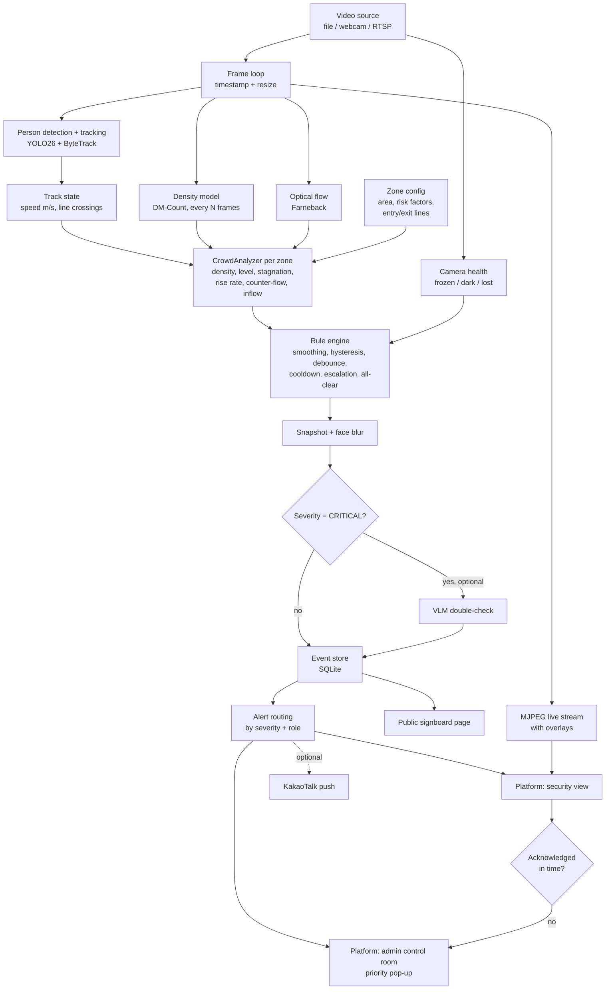

# Architecture — 숨터 Sumteo

One video-analytics engine with one goal: **prevent crowd crush (Itaewon-type disasters)**.
It watches not only *how many* people are in a zone, but *how the crowd behaves*: stuck, filling up fast,
pushing against itself. Those are the signals that turn a crowded street into a deadly one.

> Scope: crowd only. Bridge mode was split out (kept in `../bridge-safety-ai/`).
>
> Model: the district systems Seoul built after Itaewon (AI CCTV counting people per m², 4-tier levels,
> alerts mirrored to district / city / police / fire, priority camera pop-up, public signboards, slope and
> inflow data in the risk index). This project is an open, measurable version of that loop that runs on one laptop.

---

## 1. High-level flow



---

## 2. Layers

### 2.1 Video (`src/sumteo/video/`)
- `VideoSource` wraps OpenCV `VideoCapture` for file, webcam index or RTSP URL.
- Yields `Frame(image, ts, index)`. For files, `ts` comes from the frame index / FPS so results are reproducible.
- Optional `target_fps` frame skipping keeps processing real-time on a laptop.
- **Camera health** (`health.py` — `CameraHealth`): a dead camera at a hotspot is a silent failure, so it raises
  **one** `CAMERA_HEALTH` condition per camera (`zone_id` None, `details.problems` = list of `lost` / `frozen` / `dark`),
  so several problems at once give one event.
  - **frozen:** mean abs gray difference to the previous frame (downscaled) below `camera_health.frozen_diff_below`
    (0.5) for `frozen_seconds`
  - **dark:** mean gray below `dark_mean_below`
  - **lost** (live sources only — end of file is normal): `VideoSource` tries to reopen `reconnect_attempts` times,
    `camera_health.reconnect_wait_s` (1.0) apart; then it yields placeholder frames with `image=None` once per second
    and keeps retrying, so the loop and the engine keep running.
  - **while any problem is active** the pipeline skips perception **and** the analyzers: zones hold their last level
    and emit nothing until the feed is healthy again — in particular no `ALL_CLEAR`, because a dead camera must never
    announce "calm". The overlay shows "CAMERA: <problems> — zones hold their last level". (User decision: hold last
    level, not "unknown".)
- `overlay.py` — draws boxes, IDs, zones, lines, level colors and labels, flow arrows (toggle `f`), per-zone badges
  for active rule conditions, in / out counts per zone and a camera-health badge. Korean labels go through Pillow with the
  macOS AppleSDGothicNeo font (OpenCV can't draw Hangul); if the font is missing, labels fall back to English.
- **Demo tag:** when a camera overrides `crowd.levels_ppm2`, the metrics panel shows a red line
  "DEMO THRESHOLDS: yellow … / orange … / red … /m² (not the real levels)" with the values in use, so a demo can't be
  mistaken for real danger. `CameraConfig` keeps its `overrides` dict after merging so this can be detected.

### 2.2 Perception (`src/sumteo/perception/`)
| Module | Model | Output | Frequency |
|---|---|---|---|
| `detector.py` | YOLO26n/s (person class only) + ByteTrack | `list[Detection(track_id, bbox, conf)]` | every frame |
| `density.py` | DM-Count (authors' weights: SH-B default; SH-A / NWPU per camera) | density map + count | every N frames (≈1 fps) |
| `flow.py` | OpenCV Farneback optical flow | per-zone flow speed (m/s), turbulence, counter-flow | every `models.flow_every_n_frames` |

Detector settings live in config `models:` (`detector`, `detector_imgsz` 1280, `detector_conf` 0.1, `tracker`); tracker
thresholds live in `configs/bytetrack.yaml` (high 0.2, low 0.05, new track 0.3, buffer 30 frames = `tracking.lost_after_s`
at 15 fps, match 0.95). Why: in high, wide-angle shots people are small, so imgsz 640 finds almost nobody and stock
ByteTrack churns IDs. The low `detector_conf` only feeds ByteTrack's second-stage matching; a new track still needs ≥ 0.3,
so weak false boxes don't become tracks.

**Flow** (`flow.py`): Farneback on gray frames downscaled ×0.5. Flow → px/s → each grid point to a world velocity in
m/s through the homography. Per zone, points are **weighted by the density map** at that point, so empty ground doesn't
pull the speed to 0.
- `flow_speed` = weighted mean |v| (m/s)
- a point is *moving* when |v| ≥ `crowd.flow_moving_mps` (0.3, same as `still_speed_mps`)
- `turbulence` = 1 − |weighted mean unit vector| over moving points (0 = one direction, 1 = chaotic)
- `counter_flow` = weighted share of moving points more than 90° from the main (mean) direction
- both are 0 when nothing moves
- flow runs only on the zones' bounding box (`zones_roi`, 8 px margin), not the whole frame — on the 1080×2046
  crossing frame Farneback took 41 ms per run full-frame
- `CrowdAnalyzer` smooths all three like density (median over `smoothing_s`, §2.5)

**Why two counting methods?** Detection works well up to ~2–3 people/m². In dense crowds people
are occluded and detection under-counts badly, so the density model takes over.

**Switch rule** (per zone): the density model's own people/m² decides. Below `crowd.switch_density_ppm2` (**2.0**) the
zone uses the detection count; from 2.0 up it uses the density count. The default equals the YELLOW threshold (Day 4,
user decision; was 2.5) so the YELLOW decision never rests on the detection count, which under-counts wherever people
overlap (crowd_02: 13 vs 17, 14 vs 23). Detection saturates in crowds, so it can't be
the one that triggers the switch. Before the first density run, detection is used. At low density detection is the
better count (crowd_02 zone `main`, 148 m²: detection 13.4 people on average, DM-Count SH-B 11.4, SH-A 10.5).
**Top-down cameras** where YOLO finds almost nobody must set `crowd.switch_density_ppm2: 0` in their camera YAML
(always density). This is a real camera property, not a demo value: with the default switch (2.5 then, 2.0 now), `crossing_demo`
on real thresholds counts 0 people, because NWPU's 0.88 /m² is under it and detection finds ~1 person.
The held-out run confirmed it (§5): crowd_03 / crowd_04 were set up without camera properties, so they used detection
and counted 9 and 17 people against 65 and 63 by eye (−80%). Afterwards, as a diagnostic only, NWPU on the same frames
gave 72 and 56 (within ~11%; SH-A 51 / 35, SH-B 24 / 18).

**Density weights per camera:** the default `models.density` is `models/dmcount_shb.pth` (street scenes). Dense
cameras set `models.density: models/dmcount_sha.pth` in their camera YAML `overrides:` — on the dense Shibuya clip
(crowd_05) SH-B counts 44 and SH-A 322. Very high, top-down views with tiny people use `models/dmcount_nwpu.pth`
(`crossing_demo`: NWPU 154 vs ~150 by eye; SH-A 84–140, scale-sensitive). The pipeline sums the density map inside each zone mask.
DM-Count is MIT-licensed; its model is re-declared in `perception/density.py` and loads the authors' weights.

### 2.3 Geometry (`src/sumteo/geometry/`)
- `zones.py`
  - `Polygon` — crowd area, point-in-polygon. A camera can have **several zones**; each gets its own level.
  - `Line` — entry / exit counting lines (a segment); `side(pt)` tells which side a foot point is on. What counts as a
    crossing is in §2.5.
- `calibration.py` — homography from 4 clicked image points ↔ 4 real-world points (meters).
  Converts pixel positions to meters → speeds in m/s and zone areas in m².
  Without calibration, nothing in m² or m/s is meaningful, so every camera config has one.

### 2.4 Zone config (`configs/cameras/*.yaml`)
```yaml
zones:
  - id: alley
    polygon: [[x, y], ...]          # pixels
    risk: {slope: true, narrow: true, bottleneck: false}
    entry_line: [[x1, y1], [x2, y2]] # optional, for inflow counting
    exit_line:  [[x1, y1], [x2, y2]]
```
**Risk factors** (Seoul's risk index uses slope data for the same reason — the Itaewon alley was steep and narrow):
each flag multiplies the zone's level thresholds by a factor from `crowd.risk_factors`, never below
`crowd.risk_factor_floor`. Example: slope (0.85) × narrow (0.9) → a steep alley turns RED at ~3.8 instead of 5 people/m².

### 2.5 Analytics (`src/sumteo/analytics/`)

**`state.py` — TrackState** (per track ID)
- ring buffer of `(ts, foot_point_px, foot_point_m)`
- `speed_mps` (smoothed over last ~1 s), `still_seconds`
- `seconds_in_zone: dict[zone_id, seconds]` — a camera has several zones, so time is kept per zone
- line crossings for inflow counting: `last_side` keyed by line id `"<zone>:entry"` / `"<zone>:exit"` (+1 / -1)
- `TrackStore.update(ts, detections, homography, zones)` takes all of the camera's zones and returns this frame's new
  `Crossing(ts, line_id, track_id, direction, into_zone)` list; running totals in `TrackStore.crossing_counts[line_id][direction]`

**Crossing rule** — a raw side change between frames miscounts: a foot standing on the line jitters across it, and
someone walking past a line's end crosses its infinite extension. So:
- the side is judged on the track's **median foot position** (median x and y in metres) over the last
  `tracking.speed_window_s`, and only once the track has at least half a window of history (the same rule as speed).
  Why: a half-hidden person's box shrinks and the foot point jumps 0.5–1.5 m for one frame; near the far line
  1 px ≈ 10 cm, so the band alone doesn't absorb it (crowd_02: 36 → 14 crossings)
- a side is only registered once that median foot point is ≥ `tracking.line_band_m` (0.3 m, world metres) from the line;
  inside the band the last registered side is kept, so standing on the line never counts
- a crossing = the registered side flips **and** the median foot projects onto the segment between its two endpoints
- `direction` = the new side (+1 / -1)
- **into the zone** = toward the zone centre: on any of a zone's lines (entry or exit), a crossing whose new side holds
  the zone polygon's centroid (world metres) has `into_zone = True` (inflow); the other way is outflow
- **re-cross lockout:** after a track's registered side on a line changes, a further change on that line within
  `tracking.recross_lockout_s` (3.0) updates the side but isn't counted. Why: on crowd_02 every remaining re-count was
  the same ID re-crossing the same line 0.5–1.8 s later. A teleport guard was rejected — far-away foot jitter already
  gives normal tracks single-frame steps of 20+ m/s, so it can't tell these apart
- **OUT dwell** (Day 4, user decision): an OUT crossing (`into_zone` False) counts only if the track's registered side
  was the inside side for ≥ `tracking.out_dwell_s` (**2.5**, tuned) before it crossed; IN crossings are unchanged. Why:
  extra OUTs came from tracks first registered just inside the zone (people first seen after entering, fragments after
  an ID switch). Applied to OUT only, so the in ÷ out ratio errs slightly **high** — the early-warning side; a dwell on
  both directions would also drop real INs
  - tuned on crowd_02's moved line vs the user's count (IN 5, OUT 7–8): 1.5 s → IN 5 / OUT 10; 2.5 s → 5 / 8;
    3.5 s and 5 s → 5 / 6. One short clip (~13 crossings), so treat 2.5 as a starting value, not a settled one
  - the **re-cross lockout is applied before the dwell** — otherwise a blocked OUT let an ID-switch flip-flop count as
    an IN (gave IN 6)
- no calibration (homography `None`) → line counting is skipped, because the band is in metres; zone timers still work

**`crowd.py` — CrowdAnalyzer → `CrowdMetrics`** (one analyzer per zone, per second)
- `CrowdAnalyzer(cfg, zone_id, zone_area_m2, risk_factor)`;
  `update(ts, detection_count, density_count, median_speed_mps) → CrowdMetrics`; `conditions(metrics) → list[Condition]`
- `risk_factor(cfg, zone.risk)` = product of the flagged factors, floored at `risk_factor_floor`
- **zone speed follows the count source:** a zone counted by detection uses `median_speed_mps` (tracks); a zone counted
  by density uses `flow_speed` — from high up YOLO finds almost nobody, so track speed would read 0. Exposed as
  `CrowdMetrics.speed_mps`; `STAGNATION` uses it. No new threshold. A zone hovering at the switch flips the speed source
  every update; `STAGNATION` still fires after `stagnation_seconds` (unit-tested).
- **flow metrics are smoothed like density:** `flow_speed`, `turbulence` and `counter_flow` are each a median over
  `smoothing_s`. Why: raw turbulence on `crossing_demo` jumped 0.1 ↔ 0.85 second to second, so ORANGE + turbulence → RED
  flickered. Side effect: "moving again" resets the stagnation timer only after more than one smoothing window of
  movement — it errs toward warning.
- conditions carry `details.level`, so `STAGNATION` can map to CRITICAL at ≥ ORANGE

| Metric | How |
|---|---|
| `count` | hybrid detection / density |
| `density_ppm2` | count ÷ zone area (m²), **median over the last `smoothing_s`** |
| `flow_speed` | density-weighted mean optical-flow speed in the zone, m/s (§2.2) |
| `median_speed_mps` | median walking speed of tracks in the zone |
| `speed_mps` | `median_speed_mps` if the zone is counted by detection, `flow_speed` if by density |
| `turbulence` | 1 − \|weighted mean unit vector\| of moving flow points (0 = one direction, 1 = chaotic) |
| `counter_flow` | weighted share of moving flow points > 90° from the main direction |
| `rise_ppm2_per_min` | least-squares slope of the smoothed density over the last `rise_window_s`, × 60; only once the samples span ≥ `smoothing_s` (no start-up noise) |
| `inflow_per_min` / `outflow_per_min` | `into_zone` True / False crossings on the zone's lines in the last `inflow_window_s`, × 60 ÷ `inflow_window_s` — always the full window, so a short clip doesn't extrapolate a few early crossings |
| `level` | from thresholds below, with risk factors and hysteresis |

**Levels** — thresholds from crowd-safety literature (Fruin levels of service), labeled with the Korean national
crisis-level names so operators read them the way they already do:

| Level | Label | people/m² (default) | Meaning |
|---|---|---|---|
| GREEN | 관심 Attention | < 2 | free movement |
| YELLOW | 주의 Caution | 2 – 4 | dense, restricted movement |
| ORANGE | 경계 Alert | 4 – 5 | critical, bodies touching |
| RED | 심각 Serious | ≥ 5, or ORANGE with high turbulence | crush risk — act now |

> These numbers are *not* Seoul's official thresholds (those aren't published). They warn a little earlier than
> commonly quoted crush figures (5–6+), on purpose: the system exists to buy time.

**Hysteresis:** a level goes **up** at its threshold but only comes **down** when density falls `hysteresis_ppm2`
below it (e.g. ORANGE at 4.0, back to YELLOW under 3.6). This stops a crowd sitting at 3.95–4.05 from flipping every second.
A RED reached through turbulence doesn't change the stored base level that hysteresis works from.

### 2.6 Rules → conditions

The analyzer emits `Condition`s; the rule engine decides which become events.

| Event | Condition (all thresholds in config `crowd:`) | Severity |
|---|---|---|
| `CROWD_LEVEL` | emitted every update while level ≥ YELLOW (`details.level`); the engine turns it into one event per activation / severity change | YELLOW → INFO, ORANGE → WARNING, RED → CRITICAL |
| `STAGNATION` | level ≥ `stagnation_min_level` **and** `speed_mps` < `stagnation_speed_mps` for ≥ `stagnation_seconds` — the crowd is stuck (the Itaewon pattern) | WARNING; CRITICAL if level ≥ ORANGE |
| `DENSITY_RISING` | `rise_ppm2_per_min` > `rise_ppm2_per_min` threshold while density ≥ `rise_min_density` — **early warning** before ORANGE | WARNING |
| `COUNTER_FLOW` | `counter_flow` > `counter_flow_warn` while level ≥ YELLOW — two streams colliding | WARNING |
| `INFLOW_IMBALANCE` | `inflow_per_min` ≥ `inflow_min_per_min` and inflow ÷ outflow > `inflow_ratio` over `inflow_window_s` — the zone is filling | WARNING |
| `CAMERA_HEALTH` | feed lost / frozen / dark — one condition per camera, `details.problems` (§2.1). While active, that camera's zones hold their last level and emit no other conditions (no `ALL_CLEAR`) | WARNING |
| `ALL_CLEAR` | emitted while GREEN **and** no other condition is active for that zone (so a GREEN zone's `INFLOW_IMBALANCE` doesn't get an all-clear right after its own WARNING); the engine fires it only if that zone fired WARNING/CRITICAL since its last all-clear | INFO |

Conditions are emitted **continuously** while true; deciding what
becomes an event is the engine's job. Rules not listed with a severity mapping use `DEFAULT_SEVERITY`.

Turbulence is used only inside the RED escalation for now (hard to tune as its own rule on stock video).

> **Known limitation — outflow overcounts.** On crowd_02, outflow read ~40% high before Day 4 (by eye 7–8, system 11):
> tracks that start just inside the zone and walk out, and track fragments near the line. That biases inflow ÷ outflow
> **low**, so `INFLOW_IMBALANCE` may fire late or not at all — the unsafe direction for an early warning. The OUT dwell
> (§2.5) targets this (crowd_02 after tuning: OUT 8 vs 7–8 by eye); line placement matters too (DATA.md §2, *Counting lines*).

> **Known limitation — turbulence is tuned only on calm footage.** People in a square walk in all directions, so calm
> crowds already read high: smoothed, after the first window, crowd_02 median 0.59 / p95 0.74 and crowd_06 (real
> thresholds) median 0.61 / p95 0.72, max 0.75 on both. `turbulence_red` was raised 0.6 → **0.8** (Day 4), just above
> that calm ceiling — a margin of only 0.05. With 0.6, crossing_demo skipped ORANGE (0.67 events per change). Whether
> 0.8 catches real crowd turbulence is untested: no stock footage shows it.

### 2.7 Events (`src/sumteo/events/`)
- `models.py` — `Condition(type, zone_id, track_id, details)`, `Event(id, camera_id, type, severity, ts, zone_id, details, snapshot_path, verified, acknowledged)`
- `engine.py` — `RuleEngine`
  - **key**: `(zone or track, type)`, one engine per camera; a key fires **once per activation**
  - **debounce**: per severity — a condition (or a new severity of it) must hold `debounce_s` before it fires (kills flicker)
  - **escalation**: a higher severity fires immediately, even inside a cooldown
  - **de-escalation**: a drop in severity is silent but re-arms the key, so a later rise alerts again
  - **cooldown**: a key that stops and comes back within `cooldown_s` at the same or lower severity is blocked
  - **combine**: conditions firing for the same zone in the same `update` call go out as **one** event with the highest
    severity and `details.reasons` listing all types (e.g. CROWD_LEVEL RED + STAGNATION), not as separate alerts
  - **all-clear**: one `ALL_CLEAR` when the zone returns to GREEN, only if it fired WARNING/CRITICAL since the last one
    - no cooldown on `ALL_CLEAR` — the WARNING/CRITICAL gate is enough; with a cooldown, ORANGE → GREEN → ORANGE → GREEN
      inside `cooldown_s` swallowed the second all-clear and operators were never told the zone was calm
    - firing an `ALL_CLEAR` clears that zone's cooldowns: once declared calm, a new rise is a new situation and alerts,
      even within `cooldown_s` of the previous alert

### 2.8 Alert routing (`src/sumteo/events/notifiers/`)
Alerts live **in the platform**: the people on duty watch the dashboard, so that is where alerts appear first.
Like Seoul's system, which mirrors one alert to district, city, police and fire at once — but routed by severity
and role so each group only gets what it must act on. Routes live in config `notifiers.routes`:

| Severity | Goes to | Meaning |
|---|---|---|
| INFO | admin feed | log it |
| WARNING | + **security** view | on-site guards: check the zone, get ready |
| CRITICAL | + **admin** pop-up + optional KakaoTalk | control room: act now |

- **Roles:** `security` (on-site guards, phone or tablet) and `admin` (control room). The demo picks the role on a
  simple login screen; a real deployment needs proper accounts.
- **Getting noticed:** sound + browser notification (works when the tab is in the background) + priority pop-up.
- **Acknowledge:** an alert stays highlighted until someone acknowledges it; who and when is stored.
- **Escalation** (`events/escalation.py` — `AckTracker`, API process, **wall clock** since acks are human time): any
  CRITICAL not acknowledged within `ack_timeout_s` is re-sent **once** to admin as an `escalation` message; the DB
  event's details get `escalated: "no response"` and `escalated_at`.
- **KakaoTalk (optional):** the messenger Koreans actually use. Demo: Kakao Developers "send to me" API with the
  operator's own token. Production: business channel + AlimTalk (알림톡). Sends text + a link to the event,
  not the photo, so snapshots stay on the platform.

Notifiers: `console`, `platform`, `kakao`. `PlatformNotifier` runs in the camera worker and only forwards the event to
the API process; role routing (`notifiers.routes`, roles `security` / `admin`) happens there.

### 2.9 Verification (`src/sumteo/verify/vlm.py`) — optional
For CRITICAL events only, send the **face-blurred** snapshot to a vision LLM:
"Is this crowd dangerously dense or pushing? Answer yes/no + reason."
Used to *annotate* the alert (never to suppress a CRITICAL alert silently — a human always sees it).

### 2.10 Privacy (`src/sumteo/privacy/blur.py`)
- Face **detection** only (to blur), never face **recognition**. No identities are stored.
- **What is blurred:** faces **and** heads.
  - YuNet (OpenCV `FaceDetectorYN`, MIT, ~230 KB onnx in `models/`) finds close faces. It runs at half size
    (crowd_02 32 → 8 ms, crossing 76 → 19 ms); the small faces this loses already get the head band, and what only
    YuNet catches are large, close faces of people YOLO misses.
  - The top `privacy.head_fraction` (0.2) of every YOLO person box is blurred too: in high shots faces are 5–15 px,
    too small for any face detector.
  - **Cameras with a density-counted zone** (user decisions): YOLO finds only a fraction of people there (~1 in 4 on
    crossing_demo), so the **whole frame** gets a soft Gaussian — people outside the zone too. Sigma = half a head,
    head = `privacy.head_size_m` (0.25) converted to px at each density-counted zone's centre via the homography; the
    largest of those sigmas is used (crossing_demo ~3.8 px). Faces are gone; the crowd's shape stays visible.
  - **Box blur** (faces, head bands) is a fixed-cost anonymize, not a Gaussian: shrink the padded box to 6 px across
    (`INTER_AREA`), scale back up (`INTER_LINEAR`). Why: large boxes (big padded head bands / face boxes) made huge Gaussian kernels (crossing_demo fell to
    2.3 FPS); no detail survives 6 px, so privacy is the same or stronger.
  - The masked blur uses `cv2.copyTo`, not numpy boolean indexing (full frame 6.6 ms).
  - **Known limitation:** on detection-counted cameras (crowd_02), people the tracker never picks up (far background,
    faces ~4 px) are not blurred — the head band only covers tracked boxes. Not identifiable at that size, but no
    rule covers them.
  - On a frozen feed the frame is blurred with the last known boxes.
- **Where:** right after perception, before the overlay, whenever `privacy.blur_faces` is on. Detection, density and
  flow see the raw frame. Order inside `FaceBlur.apply`: YuNet on the **raw** frame (half size) → soft frame / zone
  blur → anonymize over faces + head bands. Everything downstream — window, `--save` video, snapshots, the Day 5 MJPEG stream — gets the
  blurred one. Overlay text stays sharp on top.
- **Snapshot:** on each event, the blurred frame with its overlay is saved as JPEG to
  `events.snapshot_dir/<event id>.jpg` and `event.snapshot_path` is set.
- Snapshots are blurred before they are saved, shown on the platform or sent to a VLM. KakaoTalk gets a link, not the photo.
- Raw video is not stored by default — only event snapshots.

### 2.11 Storage and API
- `storage/db.py` — SQLite tables: `events`, `crowd_metrics` (1 row per zone per second).
  `Storage(path)` with `add_event(event)` and `add_metrics(camera_id, metrics)`; the pipeline writes `crowd_metrics` once
  per zone per second (when `int(ts)` changes) and every event as it fires. While the camera has a health problem no
  `crowd_metrics` rows are written — an honest gap, not stale rows.
- `Pipeline.run(on_frame=None)` — per-frame callback `(ts, metrics, events)`, used by `eval_crowd.py` and the Day 5 API.
- **Two clocks:** `Event.ts` and `crowd_metrics.ts` stay the video clock; `Event.created_at` / `events.created_at` and
  `crowd_metrics.wall_ts` are wall-clock epoch seconds (latency, acks, `?since=`).
- `api/server.py` — FastAPI (`create_app()`, started by `scripts/serve.py --cameras a.yaml b.yaml`)
  | Endpoint | Purpose |
  |---|---|
  | `GET /cameras` | `[{id, name, health: [problems], demo: {overridden, levels}, zones: [{id, area_m2, level, label, density_ppm2, count, count_source, speed_mps, active: [condition types], thresholds: {yellow, orange, red}}]}]` — zone thresholds include the risk factor; `demo.overridden` = the camera overrides `crowd.levels_ppm2` |
  | `GET /cameras/{id}/stream` | MJPEG with overlays (blurred frames), scaled to 960 px wide, 15 fps |
  | `GET /events?camera=&severity=` | event history |
  | `GET /events/{id}` | one event |
  | `POST /events/{id}/ack` | body `{role}`; the **first ack wins**; stores `acknowledged_by`, `acknowledged_ts` (wall) |
  | `GET /metrics/{camera}?since=` | crowd density time series; `since` in wall-clock epoch s |
  | `GET /snapshots/<id>.jpg` | static, blurred event snapshots |
  | `GET /signboard/{zone}` | `{zone, camera, level, label, message_ko, message_en, demo}` |
  | `WS /ws?role=security\|admin` | `hello` (all camera states + `open`: unacknowledged WARNING / CRITICAL events routed to that role since the server started — `Storage.open_alerts`), `camera` (one state, every second, all roles), `event` (routed by role), `ack` (all roles), `escalation` (admin) |

### 2.12 Dashboard (`dashboard/`, Next 16, React 19, Tailwind 4, Recharts)
Routes: `/` (role pick), `/admin`, `/security`, `/signboard/<zone>`.
- Camera grid with live MJPEG, zone overlays and level labels (color + 관심/주의/경계/심각)
- **Priority pop-up:** when a camera hits ORANGE/RED its feed jumps to a large view at the top with a sound,
  until acknowledged (Seoul control rooms do the same)
- Two views: **security** (my zones, big alert cards, Acknowledge — works on a phone) and **admin** (all cameras, pop-ups, history)
- Alert feed (color by severity, "Acknowledge" button, escalation mark), camera-health badges
- **Pop-ups** (admin modal, security cards) are for WARNING / CRITICAL that arrive live **and** for the open
  (unacknowledged) ones in `hello`, so a reload, a reconnecting phone or a new admin gets every open alert back as a
  pop-up with sound. Older history only fills the feed; unacked alerts from earlier server runs stay in the feed.
  An ack from either role closes the alert for both.
- **Sound:** Web Audio beeps, unlocked by the login click, or by a "tap to turn on sound" bar after a reload (browsers
  block audio until the user interacts). **Browser notifications** with `requireInteraction` on CRITICAL.
- Crowd density chart per zone with level bands
- Event detail: blurred snapshot, rules that fired, VLM note
- **Demo tag:** every view that shows a camera's level carries the same red "DEMO THRESHOLDS … (not the real levels)"
  line as the overlay (§2.1) when that camera overrides `crowd.levels_ppm2`
- **Public signboard page** (extra): full-screen level + short instruction in Korean and English
  (e.g. "Crowded — use exit B →"), the way district signboards guide people away from a jam

### 2.13 City context (extra)
Seoul's real-time city data (data.seoul.go.kr, free API key) gives a 4-level congestion label for ~120 hotspots,
estimated from mobile signals, updated every 5 min with ~15 min delay. Shown next to our live level as the
"wider area" view: our camera is precise and second-by-second, the city data is broad and slow.

---

## 3. Process model

```
scripts/serve.py --cameras a.yaml b.yaml      (uvicorn; create_app() spawns the workers)
   ├─ camera worker process × N (multiprocessing spawn): frame loop → perception → blur → analyzer → rule engine
   │     → SQLite + snapshots (written by the worker) ; queue → API:  frame (JPEG, put_nowait — dropped when full)
   │       · state (1/s) and event (`put_reliably()`: 5 s put timeout, a loud log line every 5 s while the API isn't
   │         reading, keeps retrying — never dropped, never silent)
   └─ API process: one reader thread per camera queue → Hub (api/hub.py, in-memory pub/sub) → WebSocket clients
         + MJPEG; reads SQLite and writes acks through its own connection; AckTracker (escalation)
dashboard (next dev)
   └─ talks to the API only
run_camera.py --camera …                       (single camera, local window, no API)
```
**Why processes, not threads** (measured, Day 5): two cameras as threads in the API ran 4.9 + 3.2 FPS — the
Python-heavy parts serialize on the GIL; as processes 8.8 + 4.1 FPS (alone 14.9 / 6.6; the shared GPU is the remaining
cost). File sources loop for the demo (`runtime.loop`, set by the server); the video clock keeps counting across loops.
Swap the queues + Hub for Redis only if cameras run on several machines.

---

## 4. Performance targets (MacBook M-series, 720p input)

| Item | Target |
|---|---|
| Detection + tracking (YOLO26n, 1280) | ≥ 15 FPS (measured 17–28 FPS on the Day 1 clips) |
| Density model | ~1 run/s |
| Full pipeline (Day 3, MPS) | measured: crowd_02 15.6 FPS; crossing_demo 8.6 FPS — density (928 ms/run, every 15 frames) is the main cost |
| Full pipeline + blur (Day 4) | measured: crowd_02 14.9 FPS; crossing_demo 6.6 FPS (without blur 16.5 / 8.6) |
| Alert latency (level change → dashboard) | < 3 s + debounce — measured Day 5 (two cameras, `serve.py`): rule firing (`created_at`) → WS client 0.08–1.5 s, both roles; a CRITICAL 0.34 s |
| Ack → alert closed for both roles | measured Day 5: within 2 s |
| Unacked CRITICAL → escalation | measured Day 5: re-sent to admin at exactly `ack_timeout_s` (60 s); acked CRITICALs not escalated |

---

## 5. Evaluation

| What | Dataset | Metric |
|---|---|---|
| Crowd counting | ShanghaiTech Part B test | MAE, RMSE |
| Dense crowd counting | ShanghaiTech Part A test | MAE, RMSE |
| Crowd levels | Pexels crowd videos (manual people counts per window → level) | level accuracy, off by > 1 level, count MAE |
| Alerts | labeled crowd videos | events per level change, false alarms per hour, time-to-alert |
| Rules (stagnation, rise, inflow, …) | **unit tests with fake metric sequences** | fires when it should, quiet when it shouldn't |

**Ground truth (Day 4, user decision):** people are counted by eye in each zone, on zoomed grid cells of the window's
midpoint frame, without looking at the system's output. The developer agent counts; the user spot-checks the densest
frames. Label level = count ÷ zone area, by the thresholds the run uses (real for crowd_02/03/04; the camera's demo
thresholds for crossing_demo, marked as demo). Windows are 10 s; crowd_06 gets 2 s so time-to-alert has usable resolution.
Because labels and system share the zone area, the level check tests **counting**, not the calibration (±20% area).
**Label noise ≈ ±15%:** the user counted 3 frames independently, before seeing the labels — crowd_02 15 s: 20 vs agent 23;
crowd_06 15 s: 78 vs 69; crowd_04 5 s (held-out): 58 vs 63. Differences of 8–15% go both ways, so no clear bias in
these 3 checks (too few to rule one out). Labels are kept as first counted, not swapped. A count-MAE difference
smaller than ~15% of the count can't be told apart from label noise.

**Split:** tuning = crowd_02 + crowd_06; held-out = crowd_03 + crowd_04 (`test_crowd_03.yaml`, `test_crowd_04.yaml`, real
thresholds, no overrides), run **once** after tuning. crowd_05 stays out (moving view). Tuned on 02 + 06 only:
`out_dwell_s` (→ 2.5) and `turbulence_red` (→ 0.8, above the calm ceiling of 0.75; §2.5, §2.6). Level thresholds stay Fruin —
stock footage can't tune ORANGE/RED.

**Held-out result (Day 4, run once):** one 10 s window per clip (clips are 10 s and 12.9 s). Level 2 / 2 GREEN — trivial;
count MAE 51.0 (system 9 / 17 vs 65 / 63 by eye, about −80%); 0 false alarms in 23 s. The failure is the camera setup,
not the model: from this height detection finds 1 in 4–7 people, and the switch rule kept detection below 2.5 /m² (the default then; at 2.0 the result is the same — SH-B read 0.07–0.09 /m²)
(§2.2). The result stands as measured; the held-out set is **not** re-run with fixed configs — that would turn it into
tuning data. A fix applies to the next camera.

**`eval_crowd.py --levels --labels data/processed/crowd_levels.csv --cameras <yamls>`:** one headless run per labeled
video with the camera matched by source file. Per window, the system's level and count at the labeled midpoint frame
→ level accuracy, off by > 1 level, count MAE. Alerts: level-change events per labeled change; false alarms per hour
(ORANGE/RED events on GREEN/YELLOW-labeled time), always reported **with the total footage length** (it's only minutes);
mean time-to-alert from the first labeled window at a new level to the first `CROWD_LEVEL` event at or above that severity.

Stock videos rarely show a real ORANGE/RED crush or a stuck crowd. So: real videos test counting, density and
"no false alarms at low levels"; fake metric sequences prove the rules; demo overrides show the full GREEN → RED path.
This goes into the README's limitations.

---

## 6. Out of scope (integration points for a real deployment)
What Seoul's system has that needs government access — listed so the design shows where it would plug in:
telecom base-station population data, transit-card / station-exit counts, drones over alleys,
location-targeted disaster text messages, KakaoTalk AlimTalk business channel, subway "skip station" control, police / fire dispatch systems.

---

## 7. Tech stack

| Layer | Choice |
|---|---|
| Language | Python 3.12 (ML libraries lag behind the newest Python) |
| CV / ML | OpenCV, PyTorch (MPS on Mac), Ultralytics (YOLO26, ByteTrack) |
| Density | DM-Count (PyTorch, authors' pretrained weights, MIT) |
| Overlay | OpenCV + Pillow (Hangul labels) |
| Config | YAML + Pydantic |
| API | FastAPI, uvicorn, WebSocket |
| DB | SQLite (→ Postgres later) |
| Alerts | In-platform (WebSocket + browser notifications); optional KakaoTalk API |
| Dashboard | Next.js + Tailwind + Recharts |
| Packaging | Docker + docker-compose |

> **License note:** Ultralytics is AGPL-3.0 — fine for a portfolio/open-source project.
> For a closed commercial product, buy an Ultralytics license or swap to RT-DETR (Apache-2.0).
> The detector is behind an interface (`PersonTracker`) so swapping is a one-file change.
